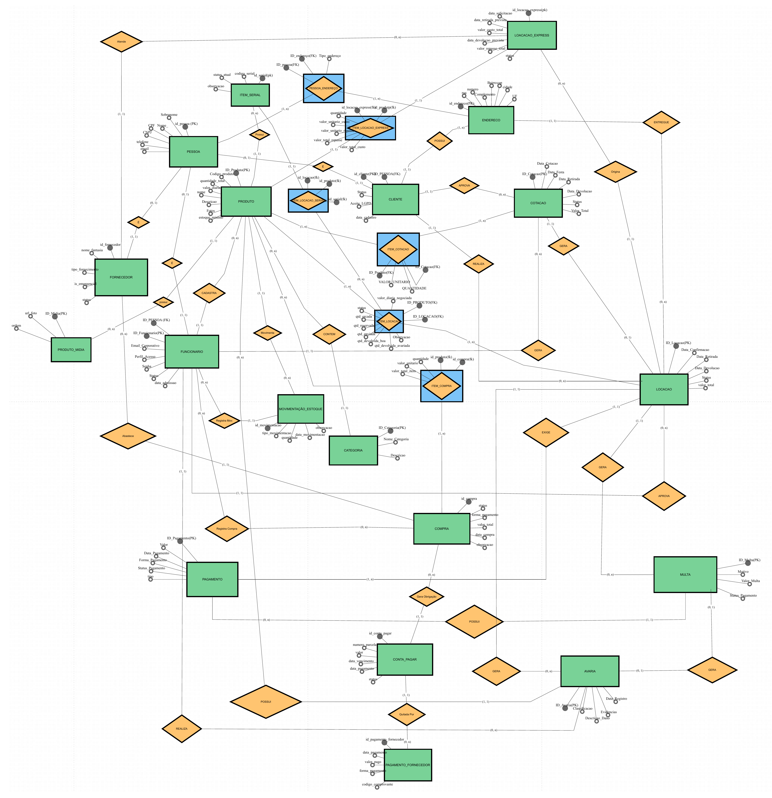

#Festa & Cia Locações

**Sistema de Locação de Produtos para Festas**

Trabalho acadêmico apresentado à disciplina de **Modelagem de Banco de Dados** da Universidade Cidade de São Paulo (**UNICID**), como requisito parcial para obtenção de nota. São Paulo, 2026.

## Sumário

- [ETAPA 01 - ESCOLHA E CARACTERIZAÇÃO DA EMPRESA](#etapa-01---escolha-e-caracterização-da-empresa)
- [ETAPA 02 - JUSTIFICATIVA DA ESCOLHA](#etapa-02---justificativa-da-escolha)
- [ETAPA 03 - IDENTIFICAÇÃO DOS PROCESSOS DE NEGÓCIO](#etapa-03---identificação-dos-processos-de-negócio)
- [ETAPA 04 - IDENTIFICAÇÃO DOS PROBLEMAS E NECESSIDADES](#etapa-04---identificação-dos-problemas-e-necessidades)
- [ETAPA 05 - LEVANTAMENTO DE REQUISITOS FUNCIONAIS](#etapa-05---levantamento-de-requisitos-funcionais)
- [ETAPA 06 - REQUISITOS NÃO FUNCIONAIS DO SISTEMA GERAL](#etapa-06---requisitos-não-funcionais-do-sistema-geral)
- [ETAPA 07 - IDENTIFICAÇÃO DAS REGRAS DE NEGÓCIO DO SISTEMA](#etapa-07---identificação-das-regras-de-negócio-do-sistema)
- [GESTÃO DE ORÇAMENTO, CAIXA E TICKET MÉDIO](#gestão-de-orçamento-caixa-e-ticket-médio)
- [ETAPA 08 - IDENTIFICAÇÃO DE RESTRIÇÕES E POLÍTICAS ORGANIZACIONAIS](#etapa-08---identificação-de-restrições-e-políticas-organizacionais)
- [ETAPA 09 - CONSTRUÇÃO DOS FLUXOGRAMAS](#etapa-09---construção-dos-fluxogramas)
- [ETAPA 10 - IDENTIFICAÇÃO DAS ENTIDADES](#etapa-10---identificação-das-entidades)
- [ETAPA 11 - IDENTIFICAÇÃO DOS ATRIBUTOS](#etapa-11---identificação-dos-atributos)
- [ETAPA 12 - IDENTIFICAÇÃO DOS RELACIONAMENTOS](#etapa-12---identificação-dos-relacionamentos)
- [ETAPA 13 - DETERMINAÇÃO DAS CARDINALIDADES](#etapa-13---determinação-das-cardinalidades)
- [ETAPA 14 - VERIFICAÇÃO DE RELACIONAMENTOS N:N EXISTENTES](#etapa-14---verificação-de-relacionamentos-nn-existentes)
- [ETAPA 15 - VERIFICAÇÃO DE RELACIONAMENTOS COM ATRIBUTOS](#etapa-15---verificação-de-relacionamentos-com-atributos)
- [ETAPA 16 - ELABORAÇÃO DO DER (DIAGRAMA ENTIDADE-RELACIONAMENTO)](#etapa-16---elaboração-do-der-diagrama-entidade-relacionamento)
- [ETAPA 17 - CONSTRUÇÃO DO DICIONÁRIO DE DADOS CONCEITUAL E 17.2](#etapa-17---construção-do-dicionário-de-dados-conceitual-e-172)
- [ETAPA 18 - JUSTIFICATIVA DAS PRINCIPAIS DECISÕES](#etapa-18---justificativa-das-principais-decisões)
- [👥 Colaboradores](#-colaboradores)

---

## ETAPA 01 - ESCOLHA E CARACTERIZAÇÃO DA EMPRESA

**Qual é o nome da empresa?**

Festa & Cia Locações.

**Qual é o segmento?**

Locação de produtos e equipamentos para festas e eventos em geral.

**O que ela vende ou oferece?**

A empresa não vende produtos físicos; ela realiza a locação. Oferece itens para eventos como: mesas, cadeiras, toalhas, capas, louças, decorações temáticas, tendas, iluminação, pula-pulas, camas elásticas e brinquedos em geral para aniversários, casamentos e eventos corporativos.

**Quem são seus principais clientes?**

- **Pessoas Físicas:** clientes que realizam festas de aniversário, casamentos ou confraternizações familiares.

- **Pessoas Jurídicas:** buffets, decoradores, cerimonialistas e empresas organizadoras de eventos.

**Quais são seus principais setores?**

- **Atendimento / Comercial:** responsável por orçamentos, cotações, reservas e geração de contratos.

- **Estoque / Logística:** controla a disponibilidade, separação, saída, transporte e retorno dos itens.

- **Financeiro:** controla pagamentos, recebimentos de sinais, débitos pendentes e cobrança de multas por atraso ou avaria.

**Como funciona atualmente?**

Atualmente, a empresa busca modernizar seu controle operacional por meio de um sistema web integrado com banco de dados relacional. O funcionamento está estruturado da seguinte forma:

- **Cadastro:** todos os clientes, produtos e usuários são cadastrados e armazenados de forma centralizada no banco de dados.

- **Consulta de Disponibilidade: quando o cliente realiza o acesso ao site, obtém todos os produtos disponíveis em estoque, alguns com disponibilidade sob consulta.**

- **Locação:** ao confirmar o pedido, o sistema gera o contrato e cria registros em ITEM_LOCAÇÃO com status Reservado.

- **Controle de Retorno e Pagamento:** na devolução dos produtos, o sistema realiza a baixa no estoque, verifica possíveis avarias e controla o status da quitação financeira.

Toda a operação será integrada, eliminando a duplicidade de informações e a perda de dados ocorridas no controle manual, garantindo agilidade e segurança.

**Quais informações são importantes para o negócio?**

- **Para o cliente:** nome/razão social, CPF/CNPJ, telefone, e-mail e endereço completo de entrega.

- **Para o produto:** nome, código (SKU), quantidade total que a empresa possui no galpão, valor da diária e valor de reposição.

- **Para a locação:** data da festa, data/hora de retirada e devolução, lista de itens, valor total, forma de pagamento, comprovantes de sinal e contrato.

## ETAPA 02 - JUSTIFICATIVA DA ESCOLHA

A escolha de uma empresa do ramo de locação de produtos para festas justifica-se por apresentar um cenário ideal para a aplicação prática dos conceitos de Análise de Sistemas e Modelagem de Banco de Dados Relacional:

- **a) Processos que podem ser analisados:**

A empresa possui processos operacionais bem definidos que necessitam de sistematização, tais como: cadastro de clientes, controle quantitativo de estoque, consulta de disponibilidade por data, geração automática de contratos, controle de logística de retirada e devolução, e gestão financeira de multas e recebimentos.

- **b) Problemas de organização das informações:**

Atualmente, as informações encontram-se descentralizadas e controladas manualmente (via WhatsApp, cadernos e planilhas). Isso gera conflitos de reservas para uma mesma data, perda de histórico de clientes, imprecisão na quantidade real disponível e falta de controle sobre pagamentos pendentes e avarias.

- **c) Necessidade de integração:**

Existe uma necessidade clara de integração em tempo real entre os setores. O Comercial precisa visualizar o estoque disponível em tempo real; o Estoque deve ser notificado sobre saídas e devoluções programadas; e o Financeiro precisa receber automaticamente os dados de faturamento, sinais e multas.

- **d) Possibilidade de aplicação de um sistema ERP:**

Por possuir setores interdependentes (Comercial, Estoque e Financeiro), a empresa apresenta potencial para aplicação de um sistema ERP modular. Este projeto atuará como o núcleo do sistema, centralizando todas as informações em um banco de dados relacional.

**Diferencial — Setor de Atendimento:**

O principal diferencial competitivo da empresa é o atendimento personalizado e consultivo, conduzido pelo Representante Comercial, que acompanha o cliente em toda jornada:

- **Antes: atendimento consultivo para entender o perfil do evento, indicando os produtos ideais para o espaço, o estilo da festa e o orçamento disponível. O representante atua como um curador, garantindo a melhor escolha.**

- **Durante: presença do representante comercial na entrega, realizando pessoalmente o checklist completo dos itens contratados no local da festa. Ele é o responsável por garantir que tudo esteja perfeito, transmitindo segurança e profissionalismo ao cliente.**

- **Depois: suporte especializado no retorno, com vistoria detalhada, coleta de evidências fotográficas e contato ativo de pós-venda para feedback. Esse acompanhamento próximo é o que gera confiança, recompra e indicação.**

**Mais do que um vendedor, nosso Representante Comercial será um elo de confiança entre a empresa e o cliente.**

## ETAPA 03 - IDENTIFICAÇÃO DOS PROCESSOS DE NEGÓCIO

### Módulo 0: Administração e Funcionários

- **Quem participa: Administrador, atendentes e sistema interno.**

- **Início: O administrador acessa o painel restrito para criar usuários, definir perfis e gerenciar privilégios de acesso para cada funcionário.**

- **O que acontece:** O sistema valida credenciais, permite ajuste de perfis e grava alterações.

- **Informação gerada:** Logs de auditoria, registros de permissão e histórico de acessos.

- **Resultado:** Equipe habilitada e permissões de acesso configuradas.

- **Exceções:** Permissões incorretas (acesso negado), falha de autenticação (bloqueio temporário).

### Módulo 01: Cadastro de Cliente

- **Quem participa:** Cliente, atendente e sistema.

- **Início:** O cliente solicita orçamento e preenche os dados cadastrais.

- **O que acontece: O sistema valida CPF/CNPJ e e-mail (que devem ser únicos), cadastra o registro com status Ativo e envia confirmação de cadastro.**

- **Informação gerada: Registro do cliente, termo de consentimento LGPD e endereços de entrega.**

- **Resultado:** Cliente apto a realizar cotações e contratos.

- **Exceções:** Dados inválidos (solicitação de correção), e-mail não confirmado (cadastro pendente).

### Módulo 02: Login do Cliente

- **Quem participa:** Cliente e sistema de autenticação.

- **Início:** O cliente insere suas credenciais na tela de login.

- **O que acontece:** O sistema valida as credenciais, aplica verificação de dois fatores (2FA) quando necessário e inicia a sessão.

- **Informação gerada:** Registro de sessão ativa, log de acesso (IP, data e hora).

- **Resultado:** Cliente autenticado com acesso ao painel de reservas.

- **Exceções: senha incorreta após 3 tentativas gera bloqueio temporário; conta com débito em aberto tem o acesso bloqueado.**

### Módulo 03: Catálogo, Cotação e Locação

- **Quem participa:** Cliente, sistema de catálogo e equipe comercial.

- **Início: O cliente navega pelo catálogo já visualizando a quantidade disponível de cada item. Itens sem disponibilidade aparecem sinalizados como indisponíveis e não podem ser selecionados.**

- **O que acontece:** O sistema verifica disponibilidade, gera a cotação (validade de 48h) e, após o pagamento do sinal de 50%, converte em locação e reserva o estoque.

- **Informação gerada:** Cotação, contrato de locação, baixa lógica no estoque e comprovante financeiro.

- **Resultado:** Cotação gerada e locação confirmada.

- **Exceções:** Produto indisponível para a data, expiração do prazo da cotação sem pagamento de sinal.

### Módulo 04: Produtos e Estoque

- **Quem participa:** Equipe de estoque/logística e sistema.

- **Início:** Entrada, saída, devolução ou manutenção de produtos.

- **O que acontece: O sistema atualiza saldos via ITEM_LOCAÇÃO, emite alertas de estoque mínimo e gerencia status dos LOTES em ITEM_LOCAÇÃO (Reservado, Enviado, Devolvido, Em Manutenção). O saldo disponível é calculado por data: TOTAL - RESERVADO - MANUTENÇÃO.**

- **Informação gerada:** Registro de movimentação, laudo de avaria e status do inventário.

- **Resultado:** Estoque atualizado e controlado.

- **Exceções:** Indisponibilidade de item, divergência de inventário.

### Módulo 05: Contrato e Financeiro

- **Quem participa:** Cliente, sistema financeiro e equipe administrativa.

- **Início:** Confirmação da locação pelo cliente.

- **O que acontece: O sistema gera o contrato de locação para assinatura digital, processa o sinal de 50% (Pix, Boleto, Cartão) com emissão de recibo, controla o saldo restante e, após quitação total, emite Nota Fiscal única pelo valor integral.**

- **Informação gerada:** Contrato assinado, recibo de pagamento e Nota Fiscal.

- **Resultado:** Locação formalizada e quitação financeira registrada.

- **Exceções: Sinal não pago em 48h, pagamento não identificado, contrato não assinado.**

### Módulo 06: Devolução, Avarias e Multas

- **Quem participa:** Cliente, equipe de logística e setor financeiro.

- **Início:** Retorno dos produtos locados.

- **O que acontece: A equipe realiza vistoria com laudo fotográfico. Se houver atraso ou avaria, o sistema aplica multa automaticamente conforme contrato e atualiza o status do item para Em Manutenção ou Inutilizado/Perda.**

- **Informação gerada:** Termo de devolução, laudo de avaria com evidências e cobrança de multa.

- **Resultado: Equipamento retornado ao estoque como Disponível ou bloqueado para manutenção, pendências financeiras tratadas.**

- **Exceções:** Atraso na devolução (> 24h), perda total ou produto avariado.

### Módulo 07: Relatórios e Dashboard

- **Quem participa:** Administrador, gestores e sistema de BI.

- **Início:** Solicitação de relatórios ou acesso ao dashboard gerencial.

- **O que acontece: O sistema compila dados de locações, financeiro e estoque, exibindo gráficos e indicadores em tempo real.**

- **Informação gerada: Relatórios de faturamento, giro de estoque (Curva ABC), inadimplência e taxa de avarias.**

- **Resultado:** Tomada de decisão fundamentada em dados em tempo real.

- **Exceções:** Dados incompletos, falha de integração.

## ETAPA 04 - IDENTIFICAÇÃO DOS PROBLEMAS E NECESSIDADES

- **Problema 1:** Controle de reservas via WhatsApp, caderno e planilhas.

- **Consequência:** Conflito de datas e locação em duplicidade do mesmo item.

- **Problema 2:** Atualização manual de estoque, sem baixa automática.

- **Consequência:** Quantidades divergentes e reserva de itens sem saldo real.

- **Problema 3:** Cadastro de clientes pulverizado em papéis e arquivos soltos.

- **Consequência:** Duplicidade de registros, perda de histórico e atraso no atendimento.

- **Problema 4:** Falta de comunicação em tempo real entre Comercial, Estoque e Financeiro.

- **Consequência:** Vendas sem checagem de estoque e atraso na identificação de débitos.

- **Problema 5:** Ausência de registro padronizado de avarias e multas.

- **Consequência:** Prejuízos financeiros e dificuldade na cobrança de danos.

- **Problema 6:** Gestão de contratos e pagamentos em papel.

- **Consequência:** Dificuldade no acompanhamento de recebimentos de sinais e emissão de notas fiscais.

- **Problema 7:** Ausência de relatórios consolidados.

- **Consequência:** Tomada de decisões sem dados confiáveis sobre faturamento e itens mais locados.

- **Problema 8:** Falta de controle de privilégios de acesso ao sistema.

- **Consequência:** Riscos de segurança e alterações indevidas nos registros.

**Necessidade Principal Identificada:**

A empresa necessita de um sistema único e integrado, baseado em banco de dados relacional, que centralize as informações de clientes, produtos, estoque, cotações, contratos, pagamentos e avarias, permitindo a comunicação em tempo real entre todos os setores.

## ETAPA 05 - LEVANTAMENTO DE REQUISITOS FUNCIONAIS

### Módulo 0: Administração e Funcionários

- **RF01 - Validação de dados:** Exigir que CPF e e-mail corporativo sejam únicos no sistema.

- **RF02 - Recuperação de senha:** Permitir redefinição de senha via e-mail ou SMS com autenticação segura.

- **RF03 - Expiração de sessão:** Realizar logout automático por inatividade do usuário.

- **RF04 - Cadastro de funcionários:** Permitir que o Administrador cadastre funcionários com nome, CPF, e-mail corporativo, telefone, perfil e senha provisória de 8 dígitos.

- **RF05 - Definição de perfil:** Configurar perfis de acesso: Admin Master, Comercial/Vendas e Estoque/Logística.

- **RF06 - Controle de status do funcionário:** Permitir alterar status para Ativo, Inativo ou Bloqueado.

- **RF07 - Login do funcionário:** Autenticar funcionários e liberar funcionalidades conforme o perfil.

- **RF08 - Alteração de senha obrigatória:** Exigir troca da senha provisória no primeiro login.

- **RF09 - Auditoria (Logs):** Registrar todas as ações dos colaboradores com identificação de nome, data, hora e ação executada.

- **RF10 - Bloqueio automático:** Bloquear o acesso do funcionário após 3 tentativas incorretas de login.

### Módulo 01: Cadastro de Clientes

- **RF01 - Cadastro completo:** Permitir inclusão de nome/razão social, CPF/CNPJ, telefone, e-mail e endereço.

- **RF02 - Status padrão:** Cadastrar automaticamente o cliente com status Ativo.

- **RF03 - Validação de documentos:** Validar formato e consistência matemática de CPF e CNPJ.

- **RF04 - Tipo de pessoa:** Classificar o cliente como Pessoa Física (PF) ou Pessoa Jurídica (PJ).

- **RF05 - Validação de contato:** Garantir unicidade de e-mail e formato válido para telefones.

- **RF06 - Busca de endereço por CEP:** Preencher logradouro, bairro, cidade e estado automaticamente ao informar o CEP.

- **RF07 - Múltiplos endereços:** Permitir o cadastro de mais de um endereço por cliente para entrega.

- **RF08 - Restrição de maioridade:** Bloquear o cadastro de menores de 18 anos.

- **RF09 - Termo LGPD:** Exigir aceite do termo de consentimento com gravação de data e hora.

- **RF10 - Edição de cadastro:** Permitir alteração exclusiva de telefone, e-mail e endereço.

### Módulo 02: Login do Cliente

- **RF01 - Criação de credenciais:** Permitir cadastro de senha forte com no mínimo 8 caracteres.

- **RF02 - Autenticação 2FA:** Exigir segundo fator de autenticação para acessos (e-mail ou aplicativo).

- **RF03 - Autenticação de cliente:** Permitir login utilizando e-mail ou CPF/CNPJ acompanhado da senha cadastrada.

- **RF04 - Bloqueio por falhas:** Suspender o acesso após 3 tentativas incorretas consecutivas.

- **RF05 - Redefinição de senha:** Enviar link temporário com token seguro para redefinição.

- **RF06 - Registro de conexões:** Gravar histórico de logins com IP, data e hora.

- **RF07 - Encerramento de sessão:** Encerrar sessão por inatividade após 15 minutos.

### Módulo 03: Catálogo, Cotação e Locação

- **RF01 - Exibição do catálogo:** Exibir produtos com foto, nome, código, descrição e valor da diária, filtráveis por categoria.

- **RF02 - Carrinho de compras:** Permitir adição, alteração de quantidade e remoção de itens.

- **RF03 - Validação de seleção:** Bloquear envio de cotação com o carrinho vazio.

- **RF04 - Registro do período:** Exigir data da festa e prazos de retirada e devolução.

- **RF05 - Controle de Disponibilidade por Data:** Um produto só pode ser confirmado para locação se existir quantidade disponível suficiente para o período da festa. Para saber o disponível, o sistema deve considerar o total de unidades que a empresa possui, descontando o que já está reservado ou o que já saiu do galpão para outros clientes na mesma data. Não é permitido confirmar uma locação que deixe o estoque negativo para a data.

- **RF06 - Bloqueio por indisponibilidade:** Alertar o cliente caso o produto não tenha saldo para a data escolhida.

- **RF07 - Restrição de cotação:** Permitir envio de orçamento apenas para clientes autenticados com status Ativo.

- **RF08 - Emissão de cotação:** Gerar cotação detalhada com código, itens, prazos, diárias e valor total.

- **RF09 - Validade do orçamento:** Expirar a cotação automaticamente após 48 horas.

- **RF10 - Notificação de vencimento:** Avisar o cliente 24 horas antes da expiração da cotação.

- **RF11 - Análise comercial:** Permitir que a equipe Comercial analise, aprove ou recuse orçamentos.

- **RF12 - Conversão em locação:** Converter cotação em contrato após confirmação e pagamento do sinal de 50%, gerando os registros correspondentes em ITEM_LOCAÇÃO a partir dos itens de ITEM_COTAÇÃO.

- **RF13 - Baixa lógica de estoque:** Reservar os itens criando registros em ITEM_LOCAÇÃO com qtd_reservada, para as datas confirmadas.

- **RF14 - Liberação de reserva:** Cancelar a reserva lógica se o sinal não for quitado dentro do prazo.

- **RF15 - Status do cliente:** Alterar status para Locado na confirmação e Bloqueado em caso de débitos.

- **RF16 - Consulta pelo cliente:** Disponibilizar painel para consulta de cotações e contratos vigentes.

- **RF17 - Regras de cancelamento:** Aplicar reembolso proporcional conforme antecedência (100% acima de 48h; 50% entre 24h e 47h; 0% abaixo de 24h).

- **RF18 - Registro do cancelamento:** Exigir confirmação do cliente para cancelar contrato.

- **RF19 - Comunicação automática:** Enviar notificações e-mail/SMS em cada etapa da locação.

- **RF20 - Auditoria de contrato:** Gravar histórico de alterações de cada contrato de locação.

### Módulo 04: Produtos e Estoque

- **RF01 - Cadastro de produto:** Permitir registro com código, nome, quantidade, valor da diária e status.

- **RF02 - Edição de produto:** Permitir atualização dos dados cadastrais dos produtos.

- **RF03 - Consulta de saldo:** Exibir quantidade total, reservada e disponível de cada item.

- **RF04 - Gestão de estoque:** Registrar entradas, saídas, devoluções e manutenções.

- **RF05 - Checagem por data:** Consultar disponibilidade considerando a agenda de eventos.

- **RF06 - Reserva de itens:** Bloquear saldo de estoque conforme as datas reservadas.

- **RF07 - Baixa automática:** Atualizar quantidade disponível na confirmação do contrato.

- **RF08 - Retorno de estoque:** Incrementar quantidade disponível na devolução física dos itens.

- **RF09 - Controle de status:** Alternar status do item entre Disponível, Locado, Em Manutenção e Inutilizado/Perda.

- **RF10 - Registro de avarias:** Permitir lançamento de danos identificados na vistoria.

- **RF11 - Trava de manutenção:** Bloquear novas reservas de itens avariados até sua liberação.

- **RF12 - Mídia e descrição:** Permitir inclusão de galeria de fotos e ficha descritiva.

- **RF13 - Alerta de estoque mínimo:** Notificar quando o saldo de estoque atingir o limite mínimo configurado.

- **RF14 - Rastreabilidade:** Registrar histórico de movimentações e alterações do estoque.

- **RF15 - Cadastro de Fornecedor:** Permitir cadastro de FORNECEDOR vinculado a PESSOA com flag is_emergencial (0=compra normal, 1=parceiro express)

- **RF16 - Registro de Compra:** Permitir registrar COMPRA com ITENS (ITEM_COMPRA) e gerar CONTA_PAGAR automaticamente

- **RF17 - Registro de Locação Express:** Permitir registrar LOCACAO_EXPRESS quando o saldo disponível (TOTAL-RESERVADO-MANUTENÇÃO) for 0

### Módulo 05: Contrato e Financeiro

- **RF01 - Emissão automática de contrato:** Gerar contrato PDF/digital automaticamente com aceite do sinal.

- **RF02 - Download de documentos:** Permitir download do contrato em PDF, DOC, TXT e PNG.

- **RF03 - Registro de pagamentos:** Armazenar pagamentos efetuados, formas e saldos devedores.

- **RF04 - Multiplataforma de pagamento:** Aceitar Boleto, Pix, Cartão de Crédito e Débito.

- **RF05 - Emissão de Nota Fiscal:** Gerar Nota Fiscal automaticamente após confirmação do pagamento.

- **RF06 - Consulta de Notas Fiscais:** Permitir ao cliente baixar todas as suas Notas Fiscais.

- **RF07 - Controle de pendências:** Apresentar saldos abertos e contas a receber para o Financeiro.

- **RF08 - Histórico financeiro:** Manter histórico de contratos, notas e pagamentos por cliente.

- **RF09 - Sincronização intersetorial:** Atualizar informações financeiras em tempo real para Comercial e Logística.

### Módulo 06: Devolução, Avarias e Multas

- **RF01 - Lançamento de multas:** Gerar cobranças automáticas vinculadas à locação por atraso ou danos.

- **RF02 - Multa por atraso:** Aplicar taxa para atrasos superiores a 24 horas (1 diária + 10% de multa ao dia).

- **RF03 - Perda total por inadimplência:** Cobrar valor de reposição integral do produto após 7 dias de atraso e alterar status do cliente para Bloqueado.

- **RF04 - Classificação de avarias:** Permitir classificação dos danos em: Leve (20% da diária), Média (50% do valor de reposição) ou Grave (100% do valor de reposição).

- **RF05 - Laudo com evidências:** Exigir descrição, assinatura do vistoriador e mínimo de 2 fotos para liberar cobrança.

- **RF06 - Destinação do produto:** Atualizar status do produto avariado com base no laudo.

- **RF07 - Bloqueio e liberação do cliente:** Bloquear cliente inadimplente e desbloquear automaticamente após a quitação.

- **RF08 - Baixa definitiva:** Dar baixa definitiva no estoque em perdas totais ou avarias graves.

### Módulo 07: Relatórios e Dashboard

- **RF01 - Visão por perfil:** Exibir painéis visuais com indicadores personalizados por perfil.

- **RF02 - Filtro por período:** Permitir filtragem de relatórios por intervalo de datas.

- **RF03 - Relatório financeiro:** Gerar demonstrativos de faturamento, recebimentos de sinais e multas.

- **RF04 - Relatório de estoque:** Emitir relatórios com posição atual do estoque (disponíveis, alocados e em manutenção).

- **RF05 - Relatório de avarias:** Listar laudos, classificações, fotos e valores cobrados.

- **RF06 - Exportação de dados:** Permitir exportação de relatórios em PDF, XLSX e CSV.

- **RF07 - Desempenho de cotações:** Apresentar taxa de conversão e expiração de orçamentos.

- **RF08 - Curva ABC de estoque:** Classificar produtos por frequência de locação e receita gerada.

- **RF09 - Relatório de inadimplência:** Listar clientes com débitos pendentes e multas em aberto.

- **RF10 - Romaneio diário:** Gerar lista de separação e conferência para logística.

- **RF11 - Perfil do cliente:** Exibir histórico de locações anteriores para atendimento personalizado.

- **RF12 - Atualização contínua:** Atualizar métricas do dashboard em tempo real.

- **RF13 - Ticket médio:** Calcular e exibir o valor médio por locação (faturamento total das locações ÷ número de locações realizadas), com filtro por período.

## ETAPA 06 - REQUISITOS NÃO FUNCIONAIS DO SISTEMA GERAL

- **RNF01 - Usabilidade:** Interface simples, responsiva e intuitiva para clientes e funcionários em dispositivos desktop e mobile.

- **RNF02 - Segurança:** Criptografia de senhas (hash seguro) e autenticação de dois fatores (2FA).

- **RNF03 - Desempenho:** Consultas de estoque e geração de cotações em tempo de resposta inferior a 3 segundos.

- **RNF04 - Compatibilidade:** Compatibilidade com os navegadores Google Chrome, Microsoft Edge e Mozilla Firefox.

- **RNF05 - Disponibilidade:** Disponibilidade de 99,0% do tempo, com rotinas automáticas de backup diário do banco de dados.

- **RNF06 - Padrão de Dados:** Utilização de Banco de Dados Relacional MySQL.

- **RNF07 - Linguagem e Arquitetura:** Desenvolvimento em PHP + MySQL.

## ETAPA 07 - IDENTIFICAÇÃO DAS REGRAS DE NEGÓCIO DO SISTEMA

### Módulo 0: Administração e Funcionários

- **RN01 - Privilégio do Admin:** Apenas usuários com perfil Admin Master podem cadastrar funcionários.

- **RN02 - Restrição a usuários operacionais:** Usuários comuns não possuem permissão para criar novos usuários.

- **RN03 - Campos obrigatórios:** Nome completo, CPF (único), e-mail corporativo (único), telefone, cargo e perfil.

- **RN04 - Escopo de permissão:**

- ADMIN MASTER: Acesso total (funcionários, produtos, relatórios e financeiro).

- COMERCIAL / VENDAS: Elabora cotações, confirma locações e gera contratos; não altera estoque nem exclui produtos.

- ESTOQUE / LOGÍSTICA: Cadastra e movimenta produtos, emite laudos de avaria; sem acesso ao financeiro detalhado.

- **RN05 - Inativação e histórico:** Funcionário inativado perde acesso imediatamente, preservando-se seu histórico para auditoria.

- **RN06 - Primeiro acesso:** Obrigatoriedade de alteração da senha provisória no primeiro login.

- **RN07 - Logs de auditoria:** Todas as ações devem registrar usuário, data e hora.

- **RN08 - Segregação de telas:** Login de funcionários realizado em URL e ambiente totalmente separados do login de clientes.

### Módulo 01: Cadastro de Cliente

- **RN01 - Unicidade cadastral:** É vedada a duplicidade de CPF/CNPJ ou e-mail no sistema.

- **RN02 - Status inicial:** O status automático pós-cadastro é Ativo.

- **RN03 - Validação de documento:** Validação matemática estrita de CPF (11 dígitos) e CNPJ (14 dígitos).

- **RN04 - Maioridade legal:** Cadastro restrito a indivíduos com idade igual ou superior a 18 anos.

- **RN05 - Registro LGPD:** Gravação obrigatória do aceite dos termos da LGPD com data e hora.

- **RN06 - Edição de dados:** O cliente pode alterar apenas telefone, e-mail e endereços.

### Módulo 02: Login do Cliente

- **RN01 - Pré-requisito:** Exige cadastro prévio ativo no banco de dados.

- **RN02 - Bloqueio temporário:** A conta é bloqueada temporariamente após 3 tentativas seguidas de senha incorreta.

- **RN03 - Expiração de sessão:** Sessão encerrada automaticamente após 15 minutos sem interação.

### Módulo 03: Catálogo, Cotação e Locação

- **RN01 - Seleção mínima:** A cotação exige ao menos 1 produto no carrinho.

- **RN02 - Validade de orçamento:** Cotação válida por 48 horas; expira automaticamente se o sinal não for quitado.

- **RN03 - Garantia de reserva (Sinal):** A reserva de estoque só é efetivada mediante pagamento comprovado do sinal de 50%.

- **RN04 - Regras de reembolso por cancelamento:**

- Cancelamento com antecedência ≥ 48h: reembolso de 100% do sinal.

- Cancelamento entre 24h e 47h: reembolso de 50% do sinal.

- Cancelamento < 24h: sem direito a reembolso do sinal.

### Módulo 04: Produtos e Estoque

- **RN01 - Atributos do produto:** Todo produto deve conter código (SKU), nome, valor da diária, valor de reposição e quantidade total que a empresa possui no galpão.

- **RN02 - Disponibilidade do produto:** Antes de confirmar uma festa, o sistema precisa garantir que o produto realmente existe para aquela data. Para isso, ele verifica quantas unidades a empresa tem no total, desconta o que já está reservado para outras festas no mesmo dia e também o que está em manutenção por avaria. Se não houver quantidade suficiente, o sistema não deixa confirmar a nova locação e avisa que não há estoque disponível para a data.

- **RN03 - Controle do lote que foi para a festa (ITEM_LOCAÇÃO):** Quando a locação é confirmada, o sistema cria um registro separado para cada tipo de produto que vai para a festa, informando quanto foi reservado, quanto realmente saiu do galpão, quanto voltou em bom estado e quanto voltou com defeito. É esse registro (ITEM_LOCAÇÃO) que guarda o status do lote como Reservado, Enviado, Devolvido ou Em Manutenção. O status nunca fica no produto.

- **RN04 - Registro de movimentações:** Toda entrada, saída, devolução, envio para manutenção, baixa por perda e ajuste de inventário deve gerar um registro em MOVIMENTAÇÃO_ESTOQUE, informando o produto, a quantidade, o funcionário responsável e a data/hora. Quando a contagem física divergir do saldo do sistema, a divergência é registrada como ajuste de inventário e o item fica bloqueado até a conferência. O saldo disponível por data continua sendo calculado (RN02) e não é armazenado.

- **RN05 - Estoque mínimo:** Cada produto possui uma quantidade mínima de estoque (estoque_minimo). Quando o saldo disponível ficar abaixo desse limite, o sistema emite alerta para a equipe de estoque/logística.

- **RN06 - Tipo de Fornecedor:** COMPRA só pode usar FORNECEDOR com is_emergencial=0. LOCACAO_EXPRESS só pode usar is_emergencial=1

- **RN07 - Conta a pagar da compra**: Cada COMPRA gera CONTA_PAGAR e a soma deve ser igual ao valor_total da COMPRA

- **RN08 - Baixa do pagamento:** PAGAMENTO_FORNECEDOR não pode pagar mais que o valor da CONTA_PAGAR

- **RN09 - Margem Express:** Em ITEM_LOCACAO_EXPRESS, valor_unitario_repasse >= valor_unitario_custo

### Módulo 05: Contrato e Financeiro

- **RN01 - Vínculo contratual:** Contrato gerado automaticamente a partir da cotação aprovada com sinal quitado.

- **RN02 - Quitação na retirada:** O saldo restante de 50% deve ser quitado até a data da retirada dos produtos.

- **RN03 - Conta a pagar da compra:** Cada COMPRA gera uma ou mais contas a pagar (CONTA_PAGAR) para pagamento ao fornecedor, uma por parcela, com valor, data de vencimento e status (Aberta, Paga, Vencida ou Cancelada). A soma das contas deve ser igual ao valor_total da COMPRA, e a compra só é considerada quitada quando todas as suas contas estiverem pagas. Se a compra for cancelada, as contas ainda abertas passam para Cancelada.

- **RN04 - Baixa do pagamento ao fornecedor:** O pagamento de uma conta a pagar (Pix, boleto, cartão ou transferência) é registrado em PAGAMENTO_FORNECEDOR, com data, valor pago, forma de pagamento e comprovante. Uma conta pode ser quitada em um ou mais pagamentos, e passa para Paga quando a soma dos valores pagos atinge o valor da conta. Não é permitido pagar mais do que o valor da conta.

### Módulo 06: Devolução, Avarias e Multas

- **RN01 - Tolerância no atraso:** Tolerância de até 1 hora no horário de devolução antes da cobrança de multa.

- **RN02 - Cálculo de multa por atraso:** Atrasos superiores a 24 horas implicam a cobrança de 1 diária integral + multa de 10%/dia.

- **RN03 - Caracterização de perda:** Atrasos superiores a 7 dias convertem-se em cobrança pelo valor integral de reposição e bloqueio do cliente.

- **RN04 - Laudo com evidências:** Cobrança de avarias exige laudo com descrição, assinatura do vistoriador e mínimo de 2 fotos.

- **RN05 - Multa por atraso:** Nem toda multa depende de avaria. Multas originadas por atraso na devolução não possuem laudo de avaria associado, sendo vinculadas apenas à LOCAÇÃO.

- **RN06 - Perdão / Isenção de Multa por Avaria Leve:** Laudos classificados como 'Leve' podem ser isentados de cobrança a critério do perfil Admin Master ou Comercial. Neste caso, a AVARIA é registrada com qtd_avariada e evidências, mas não gera MULTA associada. O sistema deve registrar quem autorizou o perdão.

- **RN07 - Multa sem Parcelamento:** A multa deve ser paga em parcela única, à vista, junto com o fechamento da locação ou em até 10 dias após o registro da avaria. Não é permitido parcelamento de multa.

### Módulo 07: Relatórios e Dashboard

- **RN01 - Atualização contínua:** Os indicadores do dashboard atualizam-se em tempo real a cada transação.

- **RN02 - Acesso restrito:** Relatórios sensíveis (financeiro, inadimplência) só são visíveis para perfis autorizados.

- **RN03 - Base de cálculo do ticket médio:** O cálculo utiliza o atributo valor_total da LOCAÇÃO, considerando somente as locações que efetivamente contribuíram para o faturamento no período analisado.

- **Associação com o ticket médio:** a explicação detalhada de como o ticket médio é calculado e usado na gestão de orçamento e caixa está na seção "GESTÃO DE ORÇAMENTO, CAIXA E TICKET MÉDIO", logo a seguir (relacionada aos requisitos RF03 e RF13 e a esta regra RN03).

## GESTÃO DE ORÇAMENTO, CAIXA E TICKET MÉDIO

Esta seção complementa as ETAPAS 05, 07 e 17, descrevendo em linguagem corrida como os requisitos e as regras financeiras já definidos (Módulos 03, 05, 06 e 07) se conectam na rotina da empresa, a partir das entidades COTAÇÃO, LOCAÇÃO, PAGAMENTO, AVARIA e MULTA. Nada do que foi definido nas etapas anteriores é alterado: o texto apenas explica e relaciona o que já consta no trabalho.

- **Gestão de Orçamento e Caixa**

Cuidar do dinheiro da empresa vai muito além de registrar pagamentos. É importante saber quanto a empresa tem para receber, quais locações já foram pagas, quais clientes ainda possuem valores pendentes e quais cobranças surgiram após a devolução dos produtos.

Por isso, a gestão de orçamento e caixa será integrada ao sistema de locações. Dessa forma, quando um cliente solicitar um orçamento, o sistema já registra o valor total da contratação (atributo valor_total da COTAÇÃO) e acompanha todo o caminho financeiro até o encerramento da locação.

**Como funciona na prática**

Tudo começa com o orçamento. O cliente escolhe os produtos que precisa para sua festa, informa a data do evento e recebe uma cotação com os itens, quantidades, valores e valor total. Essa cotação fica disponível por 48 horas (Módulo 03 – RN02) e, para que a reserva seja realmente confirmada, o cliente precisa realizar o pagamento de um sinal correspondente a 50% do valor da locação (Módulo 03 – RN03).

Depois que o sinal é identificado, o sistema transforma o orçamento em uma locação confirmada (Módulo 05 – RN01) e registra esse recebimento no financeiro, como um lançamento da entidade PAGAMENTO vinculado à LOCAÇÃO. O restante dos 50% deve ser pago até a retirada dos produtos (Módulo 05 – RN02). Assim, a empresa consegue visualizar com facilidade o que já entrou no caixa e o que ainda precisa ser recebido.

**Controle do caixa**

O caixa deve apresentar de forma simples os valores que entram e os valores que ainda estão previstos para entrar. Entre os principais recebimentos estão:

- sinais de 50% das locações;

- pagamentos dos saldos restantes;

- valores de multas por atraso;

- cobranças relacionadas a avarias ou perda de produtos;

- outros recebimentos vinculados aos contratos.

Cada pagamento deve ficar relacionado à respectiva locação, permitindo consultar o valor, a data, a forma de pagamento e o status da quitação, informações que correspondem aos campos valor, data_pagamento, forma_pagamento e status_pagamento da entidade PAGAMENTO. O sistema também deve manter o histórico financeiro de cada cliente.

Além disso, o sistema permite trabalhar com diferentes formas de pagamento, como Pix, boleto e cartão. Isso facilita a rotina do cliente e, ao mesmo tempo, evita que a equipe precise procurar comprovantes em diferentes lugares.

**Acompanhamento do que ainda falta receber**

Um dos pontos mais importantes para o controle do caixa é não olhar somente para aquilo que já foi pago. A empresa também precisa saber o que está pendente.

Por exemplo, se uma locação custa R$ 1.000,00, o sistema registra o recebimento inicial de R$ 500,00 e deixa os outros R$ 500,00 como saldo pendente até que o cliente faça a quitação.

**Valor da locação** → **Sinal recebido** → **Saldo pendente** → **Pagamento final** → **Situação da locação.**

Essa sequência corresponde ao valor_total da LOCAÇÃO, aos lançamentos de PAGAMENTO dos tipos Sinal e Saldo e ao status da locação (Ativa, Concluída ou Cancelada).

**Controle de multas e avarias**

A gestão financeira também continua depois da festa. Quando os produtos retornam, a equipe realiza uma vistoria. Caso exista atraso ou algum produto tenha sido danificado, a ocorrência pode gerar uma cobrança adicional.

O sistema registra a avaria, o laudo, as evidências e a multa correspondente (entidades AVARIA e MULTA, relacionadas na proporção 1:1 conforme a ETAPA 13). Em caso de atraso superior a 24 horas, por exemplo, existe uma regra definida no projeto para cobrança de uma diária integral mais 10% de multa ao dia (Módulo 06 – RN02). Já situações de perda possuem uma regra específica de cobrança pelo valor de reposição (Módulo 06 – RN03).

**Visão do orçamento da empresa**

Além de controlar o dinheiro recebido dos clientes, a gestão de orçamento deve ajudar a empresa a entender sua própria situação financeira.

O gestor poderá acompanhar os valores previstos e realizados, observando:

- quanto foi faturado com as locações;

- quanto já foi recebido;

- quanto ainda está em aberto;

- quanto entrou por meio de multas;

- quais contratos estão pendentes;

- quais períodos tiveram maior movimentação financeira;

- quais produtos geram maior receita.

Com essas informações organizadas no sistema, o financeiro deixa de depender de anotações espalhadas em WhatsApp, cadernos e planilhas e passa a fazer parte de uma visão integrada de toda a empresa. Essa integração atende diretamente a um dos principais problemas identificados no projeto e é apoiada pelos relatórios do Módulo 07 (RF02 – filtro por período, RF03 – relatório financeiro, RF08 – curva ABC e RF09 – inadimplência).

- **Ticket Médio**

O ticket médio é um indicador que ajuda a entender, de forma simples, quanto cada cliente costuma gastar, em média, em uma locação.

Como a empresa trabalha com diferentes tipos de produtos e cada festa possui necessidades diferentes, o valor de uma locação pode variar bastante. Um cliente pode contratar apenas mesas e cadeiras, enquanto outro pode precisar de uma estrutura mais completa, com toalhas, louças, decoração, brinquedos, iluminação e outros itens.

**Ticket Médio = Faturamento total das locações ÷ Número de locações realizadas**

Por exemplo, se em determinado período realizarmos 10 locações e faturarmos R$ 10.000,00, o ticket médio será de R$ 1.000,00 por locação.

Esse indicador permite que a empresa tenha uma visão mais clara do seu desempenho comercial. Em vez de olhar somente para o faturamento total, a gestão consegue perceber quanto cada contrato representa, em média, para o negócio.

O ticket médio também pode ser analisado junto com os dados do orçamento e do caixa. Como o projeto estabelece que a locação é confirmada após o pagamento de um sinal de 50%, uma contratação de R$ 1.000,00 gera inicialmente R$ 500,00 recebidos e outros R$ 500,00 previstos para pagamento até a retirada dos produtos.

Além disso, acompanhar o ticket médio ao longo do tempo pode nos ajudar a perceber mudanças no comportamento dos clientes. Se o valor médio das locações aumentar, a empresa poderá investigar quais produtos ou combinações de produtos estão contribuindo para esse crescimento. Da mesma forma, se o ticket médio diminuir, será possível analisar se os clientes estão realizando eventos menores ou escolhendo opções de menor valor.

Assim, o ticket médio deixa de ser apenas um número e passa a ser uma ferramenta para compreender melhor as vendas, os clientes e a movimentação financeira.

No sistema, o ticket médio é um indicador calculado, e não um campo armazenado em tabela: utiliza o atributo valor_total da entidade LOCAÇÃO, considerando somente as locações que efetivamente contribuíram para o faturamento no período analisado, e é exibido no relatório e no dashboard financeiro (Módulo 07 – RF03 e RF13, com a regra RN03).

## ETAPA 08 - IDENTIFICAÇÃO DE RESTRIÇÕES E POLÍTICAS ORGANIZACIONAIS

### Restrições

- **Orçamentárias:** Projeto com orçamento limitado, exigindo uso de tecnologias de código aberto (PHP/MySQL).

- **Prazo:** Prazo de conclusão alinhado ao cronograma acadêmico.

- **Recursos Humanos:** Equipe técnica reduzida com atribuição clara de funções.

- **Legais e Regulatórias:** Conformidade obrigatória com a LGPD (Lei nº 13.709/2018).

### Políticas Organizacionais

- **Política de Segurança da Informação:** Controle estrito de privilégios, criptografia e rotinas diárias de backup.

- **Política de Qualidade:** Vistorias de devolução padronizadas com checklists e registro fotográfico.

- **Política de Ética e Compliance:** Regras transparentes de cancelamento, prazos e reembolsos.

## ETAPA 09 - CONSTRUÇÃO DOS FLUXOGRAMAS

Os fluxogramas operacionais do sistema representam o fluxo lógico dos Módulos 0 a 07:

### Módulo 0 – Administração e Funcionários

.jpg)

*Fluxo resumido: Login Restrito → Validação de Perfil → Painel de Gestão de Usuários e Permissões.*

### Módulo 01 – Cadastro de Cliente

.jpg)

*Fluxo resumido: Preenchimento de Dados → Checagem de Unicidade (CPF/CNPJ/E-mail) → Aceite LGPD → Gravação Ativo.*

### Módulo 02 – Login do Cliente

.jpg)

*Fluxo resumido: Credenciais → Validação → Verificação 2FA → Início de Sessão.*

### Módulo 03 – Catálogo, Cotação e Locação

.jpg)

*Fluxo resumido: Seleção de Produtos → Checagem de Estoque por Data → Emissão de Cotação → Aprovação Comercial → Sinal (50%) → Contrato Gerado.*

### Módulo 04 – Produtos e Estoque

.jpg)

*Fluxo resumido: Movimentação → Atualização de Saldo → Alertas de Estoque Mínimo / Trava de Manutenção.*

### Módulo 05 – Contrato e Financeiro

.jpeg)

*Fluxo resumido: Confirmação da Locação → Geração do Contrato em PDF → Registro das Condições de Pagamento → Processamento (PIX, Boleto ou Cartão) → Aprovação ou Pendência → Integração com Comercial e Estoque → Histórico Financeiro.*

### Módulo 06 – Devolução, Avarias e Multas

.jpeg)

*Fluxo resumido: Devolução pelo Cliente → Vistoria dos Itens → Identificação de Atraso ou Avaria → Cálculo da Multa / Classificação (Leve, Média, Grave) → Quitação dos Débitos → Bloqueio ou Reativação do Cliente.*

### Módulo 07 – Relatórios e Dashboard

.jpeg)

*Fluxo resumido: Identificação do Perfil (Administrador ou Gestor) → Filtros por Período → Compilação de Dados de Locações, Financeiro e Estoque → Gráficos e Indicadores em Tempo Real → Exportação (PDF, Excel ou CSV).*

### Módulo 08 – Compras e Contas a Pagar

.jpeg)

*Fluxo resumido: Alerta de Estoque Mínimo ou Solicitação Manual → Funcionário pede cotação a FORNECEDOR de compra normal (is_emergencial = 0) → Registro da COMPRA com seus ITENS (ITEM_COMPRA: quantidade e valor_unitario) e geração da CONTA_PAGAR (valor, data_vencimento e numero_parcela) → Conferência dos produtos recebidos com a Nota Fiscal (NF) → Registro de divergência nas observações da COMPRA ou Marcação da COMPRA como Recebida com movimentação de Entrada por item, responsável FUNCIONÁRIO e soma em qtd_total_patrimonio do PRODUTO → Fim - Compra com Divergência ou Estoque Reposto.*

### Módulo 09 - Pagamento aos Fornecedores

.jpeg)

*Fluxo resumido: Vencimento de CONTA_PAGAR de uma COMPRA → Funcionário informa pagamento (data_pagamento, valor_pago, forma_pagamento e código do comprovante) → Validação se o valor pago ultrapassa o saldo devedor → Grava PAGAMENTO_FORNECEDOR ligado à CONTA_PAGAR → Verificação se a soma dos pagamentos atinge o valor total da conta → Atualização da CONTA_PAGAR para Paga com data_pagamento ou Manutenção como Aberta com saldo parcial → Fim - Fornecedor Pago ou Conta com Saldo a Pagar.*

### Módulo 10 - Locação Express

.jpeg)

*Fluxo resumido: Solicitação do Cliente com Saldo Zero no Acervo → Decisão de Atender via Locação Express → Busca de Fornecedor Parceiro Emergencial → Verificação de Disponibilidade → Registro da Locação Express vinculada à Locação do Cliente (com Custo e Repasse) → Cálculo da Margem (Repasse - Custo) → Validação de Lucratividade (Repasse < Custo?) → Cancelamento da Operação ou Conclusão - Cliente Atendido sem Aumentar Patrimônio.*

## ETAPA 10 - IDENTIFICAÇÃO DAS ENTIDADES

Com base na análise de processos, foram identificadas as seguintes entidades:

- **PESSOA:** Representa a entidade genérica que centraliza os dados comuns a indivíduos no sistema, servindo como supertipo para Cliente e Funcionário a fim de evitar redundância de atributos como nome e CPF.

- **CLIENTE:** Dados específicos do contratante que realiza cotações e contratos de locação, vinculado a uma PESSOA.

- **FUNCIONÁRIO:** Dados do colaborador interno (Administrador, Comercial e Estoque), vinculado a uma PESSOA.

- **ENDEREÇO:** Armazena os endereços de Pessoa (Cliente/Funcionário) e os locais de entrega/retirada da Locação.

- **PESSOA_ENDEREÇO:** Entidade associativa entre PESSOA e ENDEREÇO, que registra os vínculos e a finalidade (entrega, cobrança ou comercial) de cada endereço cadastrado.

- **FORNECEDOR:** Representa a entidade jurídica ou física responsável pelo abastecimento do acervo. Centraliza os dados de empresas que fornecem produtos para compra definitiva, materiais de reposição, serviços de manutenção e parcerias para atendimento em regime emergencial / express (sub-locação). Possui identificação própria (id_fornecedor) e existe de forma independente, servindo como supertipo para origem das entidades COMPRA e LOCACAO_EXPRESS. Vincula-se a PESSOA para reaproveitamento de dados cadastrais como razão social, CNPJ e contatos, evitando redundância.

- **COMPRA:** Representa o evento de aquisição definitiva de produtos para aumento do patrimônio do galpão. Possui identificação própria (id_compra) e numeração independente, existindo como documento de negócio mesmo sem itens. Centraliza informações de data, valor total, forma de pagamento e status. Quando recebida, gera aumento em PRODUTO.qtd_total_patrimonio e gera movimentação do tipo Entrada em MOVIMENTACAO_ESTOQUE.

- **ITEM_COMPRA:** Entidade associativa entre COMPRA e PRODUTO. Criada para resolver o relacionamento N:N, onde uma compra pode conter N produtos diferentes e um mesmo produto pode ter sido adquirido em N compras distintas ao longo do tempo. Sua chave primária é composta (id_compra, id_produto) e guarda os atributos específicos da negociação como quantidade, valor unitário e valor total do item.

- **CONTA_PAGAR:** Representa a obrigação financeira gerada por uma COMPRA para pagamento ao fornecedor. Cada registro é uma conta (ou parcela) com valor, data de vencimento, data de pagamento e status. Só faz sentido vinculada à COMPRA que a originou, sendo, por isso, uma entidade fraca em relação à COMPRA.

- **PAGAMENTO_FORNECEDOR:** Registra a baixa de uma conta a pagar, isto é, o Pix, boleto, cartão ou transferência que quita total ou parcialmente uma CONTA_PAGAR. Guarda a data, o valor pago, a forma de pagamento e o comprovante de cada baixa. Só faz sentido vinculada à conta que quitou, sendo, por isso, uma entidade fraca em relação à CONTA_PAGAR.

- **LOCACAO_EXPRESS (LOCAÇÃO FORNECEDOR):** Representa o evento de sub-locação temporária de produtos junto a fornecedores parceiros para atendimento emergencial. Possui identificação própria (id_locacao_express) e existe para suprir a indisponibilidade temporária do acervo próprio, quando o cálculo TOTAL - RESERVADO - MANUTENÇÃO = 0. Diferente da COMPRA, não gera aumento de patrimônio (qtd_total_patrimonio), apenas gera disponibilidade temporária e custo operacional. Vincula-se a FORNECEDOR, a FUNCIONÁRIO e à LOCAÇÃO do cliente que originou a necessidade.

- **ITEM_LOCACAO_EXPRESS:** Entidade associativa entre LOCACAO_EXPRESS e PRODUTO. Resolve o relacionamento N:N, informando qual produto foi sub-locado, quantidade, custo que foi pago ao fornecedor e valor de repasse cobrado do cliente final. Sua chave primária é composta (id_locacao_express, id_produto).

- **CATEGORIA:** Agrupa os produtos do acervo por classe/tipo (ex.: Mobiliário, Brinquedos).

- **PRODUTO:** Representa os materiais do inventário disponíveis para locação.

- **MOVIMENTAÇÃO_ESTOQUE:** Registra cada entrada, saída, devolução, envio para manutenção, baixa por perda ou ajuste de inventário de um produto, formando o histórico de rastreabilidade do estoque.

- **COTAÇÃO:** Registra os orçamentos solicitados pelos clientes.

- **ITEM_COTAÇÃO:** Entidade associativa entre COTAÇÃO e PRODUTO.

- **ITEM_LOCAÇÃO**: Entidade associativa entre LOCAÇÃO e PRODUTO.

- **ITEM_SERIAL:** Representa a unidade física individual de um produto que exige controle individualizado, com tipo_controle = SERIALIZADO. Ex: Pula-pula Rosa 001, Pula-pula Rosa 002, Cama Elástica Azul 001. Permite rastrear exatamente qual unidade foi para qual festa, qual está em manutenção e qual foi baixada por perda. Entidade obrigatória para produtos de alto valor unitário.

- **ITEM_LOCACAO_SERIAL:** Entidade associativa criada para resolver o relacionamento N:N entre ITEM_LOCAÇÃO e ITEM_SERIAL. Registra qual unidade serializada específica foi enviada em um lote de locação. Permite o controle de rastreabilidade total exigido na devolução e no laudo de avaria por unidade.

- **LOCAÇÃO:** Registra os contratos de locação formalizados.

- **PAGAMENTO:** Armazena os lançamentos financeiros (sinais, quitações e multas).

- **AVARIA:** Registra os laudos de vistoria e evidências de danos na devolução.

- **MULTA:** Armazena as penalidades financeiras emitidas por atraso ou avaria.

- **PRODUTO_MIDIA:** Entidade fraca de PRODUTO que armazena N fotos por produto para o catálogo do site.

## ETAPA 11 - IDENTIFICAÇÃO DOS ATRIBUTOS

A partir das entidades definidas na ETAPA 10, foram identificados os atributos que compõem cada uma delas, já indicando as chaves primárias (PK) e estrangeiras (FK) que sustentam os relacionamentos do modelo:

| **Entidade** | **Atributos Identificados** |
| --- | --- |
| **PESSOA** | id_pessoa (PK), nome, sobrenome, cpf, cnpj, telefone, email |
| **CLIENTE** | id_pessoa (FK), id_cliente (PK), status, aceite_lgpd, data_cadastro |
| **FUNCIONÁRIO** | id_funcionario (PK), id_pessoa (FK), email_corporativo, perfil_acesso, senha, status, data_admissao |
| **ENDEREÇO** | id_endereco (PK), cep, rua, numero, complemento, bairro, cidade, uf |
| **PESSOA_ENDEREÇO** | id_pessoa (PK/FK), id_endereco (PK/FK), tipo_endereco |
| **FORNECEDOR** | id_fornecedor(PK), id_pessoa(FK), nome_fantasia, tipo_fornecimento(Mobiliário, Toalhas, Manutenção), is_emergencial, status(ativo, inativo) |
| **COMPRA** | id_compra(PK), id_fornecedor(FK), id_funcionario(FK), data_compra, valor_total, status(Pendente, Recebida, Cancelada), forma_pagamento(Pix, Boleto, Cartão, Transferência), observacao |
| **ITEM_COMPRA** | id_compra(PK/FK), id_produto(PK/FK), quantidade, valor_unitario, valor_total_item |
| **CONTA_PAGAR** | id_conta_pagar (PK), id_compra (FK), numero_parcela, valor, data_vencimento, data_pagamento, status(Aberta, Paga, Vencida, Cancelada) |
| **PAGAMENTO_FORNECEDOR** | id_pagamento_fornecedor (PK), id_conta_pagar (FK), data_pagamento, valor_pago, forma_pagamento(Pix, Boleto, Cartão, Transferência), codigo_comprovante (NULO) |
| **LOCACAO_EXPRESS** | id_locacao_express (PK), id_fornecedor (FK), id_funcionario (FK), id_locacao_cliente (FK), data_solicitacao, data_retirada_prevista, data_devolucao_prevista, valor_custo_total, valor_repasse_total, status |
| **ITEM_LOCACAO_EXPRESS** | id_locacao_express (PK/FK), id_produto (PK/FK), quantidade, valor_unitario_custo, valor_unitario_repasse, valor_total_custo, valor_total_repasse |
| **CATEGORIA** | id_categoria (PK), nome_categoria, descricao |
| **PRODUTO** | id_produto (PK), id_categoria (FK), id_funcionario (FK), nome, codigo_produto, valor_diaria_atual, descricao, valor_reposicao, qtd_total_patrimonio, estoque_minimo, tipo_controle(FUNGIVEL OU SERIALIZADO) |
| **PRODUTO_MIDIA** | id_midia (PK), id_produto (FK), url_foto, ordem |
| **MOVIMENTAÇÃO_ESTOQUE** | id_movimentacao (PK), id_produto (FK), id_funcionario (FK), id_locacao (FK, NULO), tipo_movimentacao, quantidade, data_movimentacao, observacao |
| **COTAÇÃO** | id_cotacao (PK), id_cliente (FK), id_funcionario (FK), data_cotacao, data_festa, data_retirada, data_devolucao, status, valor_total |
| **ITEM_COTAÇÃO** | id_cotacao (PK/FK), id_produto (PK/FK), quantidade, valor_unitario |
| **LOCAÇÃO** | id_locacao (PK), id_cotacao (FK), id_cliente (FK), id_funcionario (FK), id_endereco (FK), data_confirmacao, data_retirada, data_devolucao, status, valor_total |
| **ITEM_SERIAL** | id_serial(PK), id_produto(FK), codigo_serial, status_atual, observacao |
| **ITEM_LOCACAO_SERIAL** | id_locacao(PK/FK), id_produto(PK/FK), id_serial(PK/FK) |
| **PAGAMENTO** | id_pagamento (PK), id_locacao (FK), id_multa (FK, NULO), valor, data_pagamento, forma_pagamento, tipo, status_pagamento |
| **AVARIA** | id_avaria (PK), id_locacao (FK), id_produto (FK), id_funcionario (FK), id_funcionario_perdao(FK), classificacao, descricao_dano, qtd_avariada, evidencias, data_registro |
| **MULTA** | id_multa (PK), id_locacao (FK), id_avaria (FK, NULO), motivo, valor_multa |

## ETAPA 12 - IDENTIFICAÇÃO DOS RELACIONAMENTOS

- **PESSOA — CLIENTE:** Uma pessoa pode se cadastrar como cliente ou não.

- **PESSOA — FUNCIONÁRIO:** Uma pessoa pode ser contratada como funcionária da empresa ou não.

- **PESSOA — PESSOA_ENDEREÇO — ENDEREÇO:** Uma pessoa pode ter vários endereços (entrega, cobrança, comercial) e um mesmo endereço pode estar vinculado a mais de uma pessoa; o vínculo é registrado na entidade associativa PESSOA_ENDEREÇO.

- **PESSOA — FORNECEDOR:** Uma PESSOA pode possuir um cadastro de FORNECEDOR. Relacionamento de extensão da PESSOA para reaproveitamento de dados cadastrais como razão social, CNPJ, IE e contatos, evitando redundância de dados entre CLIENTE e FORNECEDOR.

- **FORNECEDOR — COMPRA:** Um FORNECEDOR é a origem de uma ou mais COMPRAS. A COMPRA representa o evento de aquisição definitiva onde a empresa Pular e Brincar adquire produtos do FORNECEDOR para aumento de patrimônio. Leitura inversa: Uma COMPRA é fornecida / abastecida por exatamente 1 FORNECEDOR.

- **FUNCIONÁRIO — COMPRA:** Um FUNCIONÁRIO é responsável por registrar e negociar uma COMPRA. Garante a rastreabilidade e auditoria de quem efetuou o pedido.

- **COMPRA — ITEM_COMPRA:** Uma COMPRA é composta por um ou mais ITENS. O ITEM_COMPRA é a entidade associativa que detalha a negociação.

- **PRODUTO — ITEM_COMPRA:** Um PRODUTO pode compor vários ITENS de compras diferentes ao longo do tempo. O ITEM_COMPRA registra o histórico de preço e quantidade daquele produto.

- **COMPRA — CONTA_PAGAR:** Uma COMPRA gera uma ou mais contas a pagar ao fornecedor (por exemplo, uma por parcela). Cada CONTA_PAGAR pertence a uma única COMPRA, que é a sua origem, e o fornecedor é obtido pela própria COMPRA.

- **CONTA_PAGAR — PAGAMENTO_FORNECEDOR:** Uma CONTA_PAGAR é quitada por um ou mais pagamentos ao fornecedor (Pix, boleto, cartão ou transferência). Cada PAGAMENTO_FORNECEDOR refere-se a uma única CONTA_PAGAR, a que ele dá baixa.

- **FORNECEDOR — LOCACAO_EXPRESS:** Um FORNECEDOR parceiro com flag is_emergencial = 1 atende uma ou mais LOCAÇÕES EXPRESS em regime de sub-locação temporária para suprir indisponibilidade do acervo.

- **FUNCIONÁRIO — LOCACAO_EXPRESS:** Um FUNCIONÁRIO registra e retira a LOCACAO_EXPRESS junto ao fornecedor parceiro.

- **LOCAÇÃO (cliente) origina LOCACAO_EXPRESS:** Uma LOCAÇÃO de cliente quando não há saldo disponível (TOTAL - RESERVADO - MANUTENÇÃO = 0) pode originar uma LOCACAO_EXPRESS para não perder a venda.

- **LOCACAO_EXPRESS — ITEM_LOCACAO_EXPRESS:** Uma LOCACAO_EXPRESS é composta por um ou mais produtos sub-locados.

- **PRODUTO — ITEM_LOCACAO_EXPRESS:** Um PRODUTO pode compor vários ITENS de locação express, informando custo e valor de repasse.

- **COMPRA — MOVIMENTACAO_ESTOQUE:** Uma COMPRA quando recebida gera N movimentações do tipo Entrada, uma para cada ITEM_COMPRA.

- **LOCACAO_EXPRESS — MOVIMENTACAO_ESTOQUE:** Uma LOCACAO_EXPRESS gera movimentações do tipo Entrada por Sub-locação (quando retira do parceiro) e Devolução p/ Fornecedor (quando devolve).

- **CLIENTE — COTAÇÃO:** Um cliente solicita orçamentos de locação.

- **CLIENTE — LOCAÇÃO:** Um cliente firma contratos de locação.

- **CATEGORIA — PRODUTO:** Uma categoria agrupa diversos produtos.

- **FUNCIONÁRIO — PRODUTO:** O funcionário cadastra e mantém os produtos do acervo.

- **PRODUTO — MOVIMENTAÇÃO_ESTOQUE:** Cada entrada, saída, devolução, manutenção, baixa ou ajuste de inventário é registrado para um produto específico, formando o histórico exigido pela rastreabilidade (RF14).

- **FUNCIONÁRIO — MOVIMENTAÇÃO_ESTOQUE:** O funcionário do estoque/logística registra cada movimentação, ficando identificado no histórico.

- **COTAÇÃO — ITEM_COTAÇÃO — PRODUTO:** A cotação especifica os produtos e quantidades orçadas.

- **COTAÇÃO — LOCAÇÃO:** Uma cotação aprovada origina um contrato de locação.

- **LOCAÇÃO — ENDEREÇO:** A locação vincula-se a um endereço específico de entrega.

- **FUNCIONÁRIO — LOCAÇÃO:** O funcionário comercial aprova e gerencia o contrato.

- **FUNCIONÁRIO — COTAÇÃO:** O funcionário comercial atende e acompanha as cotações solicitadas.

- **LOCAÇÃO — PAGAMENTO:** O contrato gera lançamentos financeiros de sinal e saldo.

- **LOCAÇÃO — ITEM_LOCAÇÃO — PRODUTO**: Uma locação confirmada gera registros em ITEM_LOCAÇÃO, que representa o lote de cada produto que realmente saiu para a festa. O lote guarda qtd_reservada, qtd_enviada, qtd_devolvida_boa e qtd_devolvida_avariada.

- **ITEM_LOCAÇÃO — AVARIA:** Na devolução, a vistoria de cada lote pode gerar laudos de avaria. Cada laudo pertence a um ITEM_LOCAÇÃO específico, não à locação inteira.

- **ITEM_LOCAÇÃO — MOVIMENTAÇÃO_ESTOQUE:** As movimentações de saída e de devolução geradas por uma locação ficam vinculadas ao lote (ITEM_LOCAÇÃO) de origem; entradas de compra e ajustes de inventário não têm lote e permanecem sem esse vínculo.

- **PRODUTO — ITEM_SERIAL:** Um PRODUTO do tipo SERIALIZADO pode possuir várias unidades físicas individuais. Uma unidade pertence a um único modelo de produto.

- **ITEM_LOCAÇÃO — ITEM_SERIAL via ITEM_LOCACAO_SERIAL:** Um lote de locação (ITEM_LOCAÇÃO) pode conter várias unidades seriais específicas. Uma unidade serial em um determinado momento só pode estar em um lote de locação ativo.

- **AVARIA é de um ITEM_SERIAL (via ITEM_LOCAÇÃO):** Quando há avaria em produto serializado, o laudo aponta exatamente qual código serial foi danificado.

- **LOCAÇÃO — MULTA por ATRASO**: O encerramento do contrato pode gerar multa por atraso na devolução, mesmo sem nenhuma avaria.

- **AVARIA — MULTA por AVARIA**: Laudos classificados como Média ou Grave geram uma única multa por reposição/manutenção. Laudos Leves podem ser perdoados pelo Admin e não geram multa.

- **MULTA — PAGAMENTO**: O pagamento de uma penalidade quita a multa vinculada. Pagamentos de multa devem ser à vista, em parcela única.

- **FUNCIONÁRIO — AVARIA:** O funcionário da logística assina a vistoria e o laudo de avaria.

## ETAPA 13 - DETERMINAÇÃO DAS CARDINALIDADES

A cardinalidade mínima e máxima de cada um dos vinte e cinco relacionamentos binários identificados na ETAPA 12 foi determinada com base nas regras de negócio das ETAPAS 03 a 08, seguindo a notação (mínimo, máximo): o mínimo define a participação da entidade — total (1) ou parcial (0) — e o máximo define a multiplicidade do vínculo (1 ou N).

- **PESSOA (1,1) ↔ (0,1) CLIENTE:** A pessoa pode ainda não ter se cadastrado como cliente (0, participação parcial da pessoa) ou possuir no máximo 1 cadastro de cliente. Todo CLIENTE, por outro lado, corresponde a exatamente 1 única pessoa (participação total do cliente), evitando duplicidade de dados cadastrais.

- **PESSOA (1,1) ↔ (0,1) FUNCIONÁRIO:** A pessoa pode nunca ter sido contratada pela empresa (0, participação parcial da pessoa) ou possuir no máximo 1 vínculo empregatício ativo. Todo FUNCIONÁRIO, contudo, corresponde a exatamente 1 única pessoa (participação total do funcionário).

- **PESSOA (1,1) ↔ (0,N) PESSOA_ENDEREÇO:** Uma pessoa pode não ter nenhum endereço vinculado ainda (0, participação parcial) ou ter N vínculos ao longo do tempo. Cada registro em PESSOA_ENDEREÇO pertence obrigatoriamente a 1 única pessoa (participação total).

- **ENDEREÇO (1,1) ↔ (0,N) PESSOA_ENDEREÇO:** Um endereço pode nunca ter sido vinculado (0, participação parcial) ou ser compartilhado por N pessoas diferentes. Cada registro em PESSOA_ENDEREÇO refere-se obrigatoriamente a 1 único endereço (participação total).

- **PESSOA (1,1) ↔ (0,1) FORNECEDOR:** Uma pessoa pode ser apenas um fornecedor (0,1). Todo fornecedor obrigatoriamente é uma pessoa (1,1).

- **FORNECEDOR (1,1) ↔ (0,N) COMPRA:** Um fornecedor pode nunca ter vendido (0,N - parcial). Toda compra tem que ter exatamente 1 fornecedor (1,1 - total).

- **FUNCIONÁRIO (1,1) ↔ (0,N) COMPRA:** Um funcionário pode ter 0 ou N compras (parcial). Toda compra é registrada por 1 funcionário (total).

- **COMPRA (1,1) ↔ (1,N) ITEM_COMPRA:** Toda compra deve ter no mínimo 1 item para ser válida (1,N - total). Cada item pertence a exatamente 1 compra (1,1 - total).

- **PRODUTO (1,1) ↔ (0,N) ITEM_COMPRA:** Um produto pode nunca ter sido comprado (ex: acervo inicial) (0,N). Cada item refere-se a 1 produto (1,1).

- **COMPRA (1,1) ↔ (0,N) CONTA_PAGAR:** Uma compra pode ainda não ter gerado nenhuma conta a pagar (0, participação parcial), por exemplo enquanto está Pendente ou se for Cancelada, ou gerar N contas ao longo do pagamento (parcelas). Toda conta a pagar pertence obrigatoriamente a exatamente 1 compra (1,1, participação total), o que impede contas sem origem.

- **CONTA_PAGAR (1,1) ↔ (0,N) PAGAMENTO_FORNECEDOR:** Uma conta a pagar pode ainda não ter recebido nenhum pagamento (0, participação parcial), enquanto está Aberta, ou receber N pagamentos até ser quitada (pagamento em mais de uma baixa). Todo pagamento ao fornecedor refere-se obrigatoriamente a exatamente 1 conta a pagar (1,1, participação total), o que impede pagamentos sem origem.

- **FORNECEDOR (1,1) ↔ (0,N) LOCACAO_EXPRESS:** Um fornecedor emergencial pode atender 0 ou N locações express. Toda locação express tem 1 fornecedor parceiro (1,1).

- **LOCACAO (1,1) ↔ (0,N) LOCACAO_EXPRESS:** Uma locação de cliente pode não gerar nenhuma express (0,N) ou gerar N (se faltar vários produtos). Toda express está vinculada a 1 locação de cliente (1,1).

- **LOCACAO_EXPRESS (1,1) ↔ (1,N) ITEM_LOCACAO_EXPRESS**: Toda locação express deve ter no mínimo 1 item (1,N - total). Cada item pertence a 1 locação express (1,1).

- **PRODUTO (1,1) ↔ (0,N) ITEM_LOCACAO_EXPRESS:** Um produto pode nunca ter sido sub-locado (0,N). Cada item de express refere-se a 1 produto (1,1).

- **CLIENTE (1,1) ↔ (0,N) COTAÇÃO:** Um cliente recém-cadastrado possui 0 cotações (participação parcial do cliente), podendo realizar N cotações ao longo do tempo. Toda cotação, por sua vez, pertence a exatamente 1 único cliente autenticado (participação total da cotação), impedindo orçamentos órfãos no sistema.

- **CLIENTE (1,1) ↔ (0,N) LOCAÇÃO:** Um cliente pode nunca fechar um contrato (0 locações, participação parcial), ou firmar N locações ao longo da relação comercial. Cada locação vincula-se a exatamente 1 único cliente responsável (participação total), permitindo cobrança e histórico individualizados.

- **CATEGORIA (1,1) ↔ (0,N) PRODUTO:** Uma categoria pode ser cadastrada sem nenhum produto vinculado ainda (0, participação parcial) ou agrupar N produtos. Todo produto, entretanto, pertence a exatamente 1 categoria (participação total), o que evita itens "soltos" no catálogo.

- **FUNCIONÁRIO (1,1) ↔ (0,N) PRODUTO:** Um funcionário pode ainda não ter cadastrado nenhum produto (0, participação parcial) ou cadastrar N produtos no acervo. Todo produto é cadastrado por exatamente 1 funcionário (participação total).

- **PRODUTO (1,1) ↔ (0,N) MOVIMENTAÇÃO_ESTOQUE:** Um produto recém-cadastrado ainda não tem movimentações (0, participação parcial do produto) ou acumula N registros ao longo do tempo (entradas, saídas, devoluções, manutenções, baixas e ajustes). Toda movimentação refere-se a exatamente 1 produto (participação total), o que impede lançamentos de estoque sem item de origem.

- **FUNCIONÁRIO (1,1) ↔ (0,N) MOVIMENTAÇÃO_ESTOQUE:** Um funcionário pode ainda não ter registrado nenhuma movimentação (0, participação parcial) ou registrar N ao longo do tempo. Toda movimentação é lançada por exatamente 1 funcionário responsável (participação total), garantindo a rastreabilidade de quem alterou o estoque.

- **COTAÇÃO (1,1) ↔ (1,N) ITEM_COTAÇÃO:** Uma cotação deve conter no mínimo 1 produto no carrinho e no máximo N (participação total de ambos os lados). Cada item de cotação pertence a exatamente 1 cotação, não podendo existir de forma independente.

- **PRODUTO (1,1) ↔ (0,N) ITEM_COTAÇÃO:** Um produto recém-cadastrado pode nunca ter sido cotado (0, participação parcial do produto) ou constar em N cotações diferentes ao longo do tempo. Cada item de cotação refere-se a exatamente 1 produto específico (participação total).

- **COTAÇÃO (1,1) ↔ (0,1) LOCAÇÃO:** Uma cotação pode expirar em 48h sem originar contrato (0 locações, participação parcial da cotação) ou gerar exatamente 1 locação oficial, nunca mais de uma. Toda locação, por outro lado, deriva obrigatoriamente de 1 única cotação aprovada (participação total da locação), preservando o histórico completo da negociação.

- **ENDEREÇO (1,1) ↔ (0,N) LOCAÇÃO:** Um endereço cadastrado pode nunca ter sido usado em uma locação (0, participação parcial) ou ser reaproveitado em N contratos diferentes. Toda locação, contudo, vincula-se a exatamente 1 endereço específico de entrega e retirada (participação total).

- **FUNCIONÁRIO (1,1) ↔ (0,N) LOCAÇÃO:** Um funcionário comercial pode ainda não ter aprovado nenhum contrato (0, participação parcial) ou gerenciar N locações simultaneamente. Toda locação, entretanto, deve ser aprovada e gerenciada por exatamente 1 funcionário responsável (participação total).

- **FUNCIONÁRIO (1,1) ↔ (0,N) COTAÇÃO:** Um funcionário recém-admitido pode ainda não ter atendido nenhuma solicitação (0, participação parcial) ou atender N cotações. Toda cotação registrada no sistema deve estar vinculada a exatamente 1 funcionário responsável pelo atendimento comercial (participação total).

- **LOCAÇÃO (1,1) ↔ (1,N) PAGAMENTO:** Para ser considerada ativa e formalizada no sistema, toda locação exige a confirmação de no mínimo 1 lançamento financeiro (como o sinal de 50% ou o pagamento integral à vista), podendo receber N liquidações ao longo do contrato (participação total e multiplicidade N da locação). Por sua vez, cada pagamento vincula-se a exatamente 1 contrato de locação (participação total do pagamento), o que impede transações financeiras órfãs ou divididas entre contratos distintos.

- **LOCAÇÃO (1,1) ↔ (1,N) ITEM_LOCAÇÃO:** Uma locação deve ter no mínimo 1 lote de produto e pode ter N. Cada ITEM_LOCAÇÃO pertence a exatamente 1 locação. É aqui que fica qtd_reservada, qtd_enviada, status do LOTE.

- **PRODUTO (1,1) ↔ (0,N) ITEM_LOCAÇÃO:** Um produto pode nunca ter sido locado (0) ou aparecer em N locações ao longo do tempo. Cada ITEM_LOCAÇÃO refere-se a exatamente 1 produto.

- **ITEM_LOCAÇÃO (1,1) ↔ (0,N) AVARIA:** Um lote que foi para a festa pode voltar sem avaria (0) ou gerar N laudos. Cada avaria pertence a exatamente 1 ITEM_LOCAÇÃO. Substitui LOCAÇÃO — AVARIA e PRODUTO — AVARIA.

- **ITEM_LOCAÇÃO (0,1) ↔ (0,N) MOVIMENTAÇÃO_ESTOQUE:** Um lote que foi para a festa gera N movimentações (saída no envio e devolução no retorno) ou nenhuma, enquanto não houve envio (participação parcial). Cada movimentação pertence a no máximo 1 lote: saídas e devoluções apontam para o ITEM_LOCAÇÃO de origem (FK composta id_locacao + id_produto), enquanto entradas de compra e ajustes de inventário ficam sem vínculo (0).

- **LOCAÇÃO (1,1) ↔ (0,N) MULTA por ATRASO:** Uma locação pode gerar 0 multas (se devolver no prazo e sem avaria) ou N multas por atraso. Cada multa de atraso pertence a exatamente 1 locação e fica com id_avaria = NULL. Comprova RN05.

- **PRODUTO (1,1) ↔ (0,N) ITEM_SERIAL:** Um produto tem 0 a N seriais. Cada serial pertence a 1 produto. Se tipo_controle=SIMPLES, tem 0 seriais.

- **ITEM_LOCAÇÃO (1,1) ↔ (0,N) ITEM_LOCACAO_SERIAL:** Um lote pode ter 0 a N seriais (se for simples, 0). Cada registro de ITEM_LOCACAO_SERIAL referencia 1 lote e 1 serial.

- **ITEM_SERIAL (1,1) ↔ (0,N) ITEM_LOCACAO_SERIAL:** Um serial pode ter sido locado N vezes no histórico, mas 1 vez por locação ativa.

- **AVARIA (0,1) ↔ (0,1) MULTA por AVARIA:** Um laudo Leve pode gerar 0 multa se for perdoado (RN06). Um laudo Média/Grave gera exatamente 1 multa. Cada multa por avaria pertence a exatamente 1 laudo. Comprova RN04.

- **MULTA (1,1) ↔ (0,N) PAGAMENTO:** Uma multa pode ainda não ter sido paga (0) ou ter N tentativas, mas a quitação válida é à vista, parcela única (RN07). Todo pagamento de multa pertence a exatamente 1 multa.

- **FUNCIONÁRIO (1,1) ↔ (0,N) AVARIA:** Um funcionário da logística pode ainda não ter assinado nenhum laudo (0, participação parcial) ou assinar N vistorias de avaria ao longo do tempo. Toda avaria, contudo, deve ser assinada por exatamente 1 funcionário responsável pela vistoria (participação total), garantindo a validade jurídica do laudo.

## ETAPA 14 - VERIFICAÇÃO DE RELACIONAMENTOS N:N EXISTENTES

No modelo de negócios, foram identificados seis relacionamentos muitos-para-muitos (N:N):

**1. PESSOA × ENDEREÇO:** Uma pessoa pode ter múltiplos endereços registrados (entrega, cobrança, comercial) e um mesmo endereço pode estar vinculado a mais de uma pessoa (ex: marido e mulher no mesmo endereço).

**Solução:** Criação da entidade associativa PESSOA_ENDEREÇO. PK composta (id_pessoa, id_endereco). Atributo próprio: tipo_endereco.

**2. COTAÇÃO × PRODUTO:** Uma cotação pode possuir diversos produtos no carrinho e um mesmo produto pode figurar em várias cotações ao longo do tempo.

**Solução:** Criação da entidade associativa ITEM_COTAÇÃO. PK composta (id_cotacao, id_produto). Atributos próprios: quantidade, valor_unitario.

**3. COMPRA × PRODUTO**: Uma compra pode conter N produtos diferentes e um mesmo produto pode ter sido adquirido em N compras distintas ao longo do tempo, com preços diferentes.

**Solução:** Criação da entidade associativa ITEM_COMPRA. PK composta (id_compra, id_produto). Atributos próprios: quantidade, valor_unitario, valor_total_item. É aqui que se registra o histórico de preço de custo do produto.

**4. LOCAÇÃO × PRODUTO:** Uma locação confirmada pode conter N produtos e um mesmo produto pode ter sido locado em N festas diferentes. Este é o relacionamento mais crítico do sistema, pois guarda o controle de lote.

**Solução:** Criação da entidade associativa ITEM_LOCAÇÃO. PK composta (id_locacao, id_produto). Atributos próprios: qtd_reservada, qtd_enviada, qtd_devolvida_boa, qtd_devolvida_avariada, status_lote. Esta entidade é a origem para AVARIA e MOVIMENTAÇÃO_ESTOQUE de saída/devolução.

**5. LOCACAO_EXPRESS × PRODUTO:** Uma locação express (sub-locação com fornecedor parceiro) pode conter N produtos e um mesmo produto pode ter sido sub-locado em N atendimentos emergenciais.

**Solução:** Criação da entidade associativa ITEM_LOCACAO_EXPRESS. PK composta (id_locacao_express, id_produto). Atributos próprios: quantidade, valor_unitario_custo, valor_unitario_repasse, valor_total_custo, valor_total_repasse. Controla a margem de lucro da operação emergencial.

**6. ITEM_LOCAÇÃO × ITEM_SERIAL**: Um ITEM_LOCAÇÃO pode ter vários ITEM_SERIAL e um ITEM_SERIAL pode ter participado de várias ITEM_LOCAÇÃO ao longo do tempo (histórico).

**Solução:** Criação da Entidade Associativa ITEM_LOCACAO_SERIAL.
A PK composta já é o controle. Não precisa de atributo extra, pois qtd_reservada, qtd_enviada etc. já estão no ITEM_LOCAÇÃO pai. A existência do registro em ITEM_LOCACAO_SERIAL já significa que aquela unidade específica foi enviada.PK: (id_locacao, id_produto, id_serial)

## ETAPA 15 - VERIFICAÇÃO DE RELACIONAMENTOS COM ATRIBUTOS

As entidades associativas criadas passam a armazenar atributos próprios das associações:

- **PESSOA_ENDEREÇO:** Armazena tipo de endereço (classificação da finalidade do local vinculado à pessoa, como entrega, cobrança ou comercial).

- **ITEM_COTAÇÃO:** Armazena quantidade (unidades do produto cotadas) e valor unitário (valor da diária unitária praticada no orçamento).

- **ITEM_COMPRA:** Armazena quantidade (quantidade adquirida), valor_unitario (custo de compra pago ao fornecedor naquele lote) e valor_total_item (quantidade × valor_unitario). Atributos essenciais para cálculo de custo médio, margem de lucro e para geração da movimentação de estoque do tipo Entrada. Possui fórmula: valor_total_item = quantidade × valor_unitario.

- **ITEM_LOCAÇÃO**: Entidade associativa mais rica do modelo. Armazena qtd_reservada (o que o cliente reservou na cotação), qtd_enviada (o que efetivamente saiu do galpão - pode ser menor que a reservada por falta de saldo), qtd_devolvida_boa (o que voltou em perfeito estado), qtd_devolvida_avariada (o que voltou com dano) e status_lote (Reservado, Enviado, Devolvido Parcial, Devolvido Total, Avariado). É aqui que o cálculo de disponibilidade TOTAL - RESERVADO - MANUTENÇÃO é afetado. Sem esses atributos não é possível rastrear por lote.

- **ITEM_LOCACAO_EXPRESS:** Armazena quantidade (quantidade sub-locada), valor_unitario_custo (quanto pagamos ao fornecedor parceiro), valor_unitario_repasse (quanto cobramos do cliente final), valor_total_custo (quantidade × valor_unitario_custo) e valor_total_repasse (quantidade × valor_unitario_repasse). A diferença repasse - custo representa a margem da operação emergencial. Atributos obrigatórios para comprovação da RN de lucratividade mínima da operação express.

- **ITEM_SERIAL:** Armazena numero_serie (código único da unidade física, ex: PULA-001), status_serial (Disponível, Locado, Em Manutenção, Inutilizado) e data_aquisicao. PK id_serial | FK id_produto → PRODUTO. É entidade fraca, não associativa. Só existe se PRODUTO.tipo_controle = SERIALIZADO.

- **ITEM_LOCACAO_SERIAL:** Entidade Associativa, PK composta (id_locacao, id_produto, id_serial) | FK (id_locacao, id_produto) -> ITEM_LOCAÇÃO(id_locacao, id_produto) | FK id_serial -> ITEM_SERIAL(id_serial)

## ETAPA 16 - ELABORAÇÃO DO DER (DIAGRAMA ENTIDADE-RELACIONAMENTO)

O Diagrama Entidade-Relacionamento (DER) do sistema foi elaborado no modelo lógico e conceitual.

- **Link para visualização do DER Conceitual:**

- [https://app.brmodeloweb.com/publicview/6ae0cc5f34840331e7fe0a59](https://app.brmodeloweb.com/publicview/6ae0cc5f34840331e7fe0a59)

### MELHORIAS REALIZADAS NO MODELO CONCEITUAL

- Durante a revisão do modelo conceitual do sistema Festa & Cia Locações, foram implementadas melhorias estruturais com o objetivo de adequar o diagrama à realidade operacional da empresa e eliminar relacionamentos genéricos que não representavam fielmente o negócio.

Inicialmente, o modelo apresentava relação direta com cardinalidade **N:N** entre as entidades **LOCAÇÃO e PRODUTO**. Para correção desta inconsistência, essa relação foi desmembrada através da criação da entidade associativa **ITEM_LOCAÇÃO**, responsável por armazenar os atributos específicos da relação, como quantidade, valor unitário e subtotal. Esta mesma estrutura foi replicada para as modalidades específicas do negócio, resultando nas entidades **ITEM_LOCAÇÃO_EXPRESS e ITEM_COTAÇÃO**, vinculadas respectivamente às entidades **LOCAÇÃO_EXPRESS e COTAÇÃO**.

A partir da entidade **ITEM_LOCAÇÃO**, o modelo foi expandido para contemplar o ciclo completo da locação. Foram incluídas as entidades **PAGAMENTO, MULTA, AVARIA** e **MOVIMENTAÇÃO_ESTOQUE**. A entidade **PAGAMENTO** foi inserida para controle financeiro das locações, **MULTA** para registro de penalidades por atraso na devolução, **AVARIA** para registro de danos aos produtos, relacionando locação, produto e funcionário responsável, e **MOVIMENTAÇÃO_ESTOQUE** para controle de entrada e saída de produtos do acervo.

Outra melhoria relevante foi a inclusão da entidade **LOCAÇÃO_EXPRESS**, diferenciando-se da locação padrão por se tratar de um processo de atendimento rápido, sem necessidade de orçamento prévio, com fluxo operacional próprio. Também foram reorganizadas as entidades de pessoa, separando o cadastro base de PESSOA de suas especializações **CLIENTE e FUNCIONÁRIO**, e de suas entidades de contato e endereço **PESSOA_ENDEREÇO e TELEFONE**.

Com essas adequações, o modelo conceitual passou a representar de forma fiel os processos de orçamento, locação, locação expressa e controle operacional e financeiro da empresa *Festa **&** Cia Locações*, servindo de base sólida para a construção do modelo lógico.

### DER Lógico

- **Link para visualização do DER Lógico:**

- [https://dbdiagram.io/d/DL-Atualizado-6ae0a536aac330141034aa78](https://dbdiagram.io/d/DL-Atualizado-6ae0a536aac330141034aa78)

### ADEQUAÇÕES DE NORMALIZAÇÃO

*Visando atender às Formas Normais, o modelo conceitual foi normalizado através das seguintes adequações efetivamente implementadas no banco de dados:*

**1ª Forma Normal (1FN)** - Eliminação de atributos multivalorados e compostos:

Foi eliminada a violação da **1FN** identificada na entidade **PESSOA**, que armazenava múltiplos telefones em um único registro no atributo telefone. Para correção, o atributo foi retirado da entidade **PESSOA** e foi criada a entidade específica **TELEFONE**, com relacionamento **1:N** com **PESSOA**, onde cada telefone passou a ocupar uma linha exclusiva contendo DDD, número e tipo. A mesma adequação foi aplicada para a repetição de produtos, através da criação das entidades associativas **ITEM_LOCACAO**, **ITEM_LOCACAO_EXPRESS** e **ITEM_COTACAO**, garantindo a atomicidade dos dados.

**2ª Forma Normal (2FN)** - Dependência total da chave primária:

As entidades de movimentação e controle foram separadas para que seus atributos dependam totalmente da chave primária. As informações de pagamento, multa e avaria foram extraídas de **LOCACAO**, criando-se as entidades **PAGAMENTO, MULTA** e **AVARIA**. A entidade **MOVIMENTACAO_ESTOQUE** foi criada para controlar entrada e saída sem sobrecarregar a tabela **PRODUTO**.

**3ª Forma Normal (3FN) -** Eliminação de dependência transitiva:

Foram eliminadas dependências transitivas através da especialização de **PESSOA**. O cadastro base **PESSOA** foi separado de **CLIENTE e FUNCIONARIO**, e seus endereços foram normalizados em **PESSOA_ENDERECO** e **ENDERECO**. Desta forma, dados de endereço e de tipo de pessoa não se repetem, garantindo integridade referencial.

Com essas adequações, o modelo foi normalizado até a 3ª Forma Normal, eliminando redundâncias e garantindo a integridade, conforme implementado no banco de dados entregue.

## ETAPA 17 - CONSTRUÇÃO DO DICIONÁRIO DE DADOS CONCEITUAL E 17.2

### Dicionário de Dados Técnico Detalhado

#### Entidade: PESSOA

Centraliza os dados cadastrais comuns de identificação (pessoa física ou jurídica), servindo de base para os registros de CLIENTE e FUNCIONÁRIO e evitando duplicidade de nome, documento e contato.

| **Nome do Campo** | **Tipo de Dado** | **Tamanho/Precisão** | **Nulo?** | **Chave** | **Descrição / Regra de Negócio** |
| --- | --- | --- | --- | --- | --- |
| id_pessoa | INT | — | Não | PK | Identificador único da pessoa. Gerado automaticamente (auto incremento). |
| nome | VARCHAR | 50 | Não | — | Primeiro nome da pessoa física ou razão social/nome fantasia da pessoa jurídica. |
| sobrenome | VARCHAR | 50 | Sim | — | Sobrenome da pessoa física. Permanece vazio no caso de pessoa jurídica. |
| cpf | VARCHAR | 14 | Sim | Unique | CPF da pessoa física, validado matematicamente. Obrigatório para pessoa física e nulo para pessoa jurídica. |
| cnpj | VARCHAR | 18 | Sim | Unique | CNPJ da pessoa jurídica, validado matematicamente. Obrigatório para pessoa jurídica e nulo para pessoa física. |
| telefone | VARCHAR | 15 | Não | — | Telefone principal de contato. |
| email | VARCHAR | 100 | Não | Unique | E-mail principal para login e notificações. |

#### Entidade: TELEFONE

Armazena os telefones de contato de cada PESSOA. Uma pessoa pode ter vários telefones, e cada um é registrado em uma linha própria, com o tipo (Celular, WhatsApp, Comercial ou Recado) e a indicação de qual é o principal.

Melhoria realizada após a aplicação da normalização: o telefone ficava como um único atributo dentro de PESSOA, o que limitava o cadastro a um número por pessoa e violava a 1ª Forma Normal (atributo multivalorado). Com a criação da entidade TELEFONE, ligada à PESSOA por um relacionamento 1:N, cada número passou a ocupar uma linha própria.

| **Nome do Campo** | **Tipo de Dado** | **Tamanho/Precisão** | **Nulo?** | **Chave** | **Descrição / Regra de Negócio** |
| --- | --- | --- | --- | --- | --- |
| id_telefone | INT | — | Não | PK | Identificador único do telefone. Gerado automaticamente (auto incremento). |
| id_pessoa | INT | — | Não | FK | Pessoa dona do telefone (PESSOA). Obrigatório: um telefone não existe sem a pessoa. |
| numero | VARCHAR | 15 | Não | — | Número de telefone com DDD. Ex: (11) 99999-9999. |
| tipo | VARCHAR | 20 | Não | — | Tipo do telefone. Valores permitidos (ENUM): Celular, WhatsApp, Comercial ou Recado. |
| principal | BOOLEAN | — | Não | — | Indica se é o telefone principal da pessoa. Verdadeiro = principal. |

#### Entidade: CLIENTE

Representa pessoas físicas ou jurídicas que realizam cotações e contratam locações de materiais para eventos na plataforma.

| **Nome do Campo** | **Tipo de Dado** | **Tamanho/Precisão** | **Nulo?** | **Chave** | **Descrição / Regra de Negócio** |
| --- | --- | --- | --- | --- | --- |
| id_cliente | INT | — | Não | PK/UNIQUE | Identificador único do cliente. Gerado automaticamente (auto incremento). |
| id_pessoa | INT | — | Não | FK/UNIQUE/NOTNULL | Pessoa física ou jurídica correspondente a este cadastro de cliente (PESSOA). |
| status | ENUM | ('Ativo', 'Inativo', 'Bloqueado') | Não | — | Situação cadastral do cliente no sistema. Valor padrão: Ativo. |
| aceite_lgpd | BOOLEAN | SIM, NAO | Não | — | Confirmação de consentimento da LGPD. |
| data_cadastro | DATETIME | — | Não | — | Data e hora em que o cadastro do cliente foi realizado. Valor padrão: CURRENT_TIMESTAMP. |

#### Entidade: FUNCIONÁRIO

Armazena as informações dos colaboradores que operam o sistema e gerenciam as áreas comercial, logística e administrativa.

| **Nome do Campo** | **Tipo de Dado** | **Tamanho/Precisão** | **Nulo?** | **Chave** | **Descrição / Regra de Negócio** |
| --- | --- | --- | --- | --- | --- |
| id_funcionario | INT | — | Não | PK/UNIQUE | Identificador único do funcionário. Gerado automaticamente (auto incremento). |
| id_pessoa | INT | — | Não | FK/UNIQUE/NOTNULL | Pessoa física correspondente a este cadastro de funcionário (PESSOA). |
| email_corporativo | VARCHAR | 100 | Não | Unique | E-mail de login corporativo. |
| perfil_acesso | ENUM | ('Admin Master', 'Comercial', 'Estoque') | Não | — | Define a abrangência das permissões do usuário. |
| senha | VARCHAR | 255 | Não | NOTNULL | Hash da senha de acesso criptografada. |
| status | ENUM | ('Ativo', 'Inativo', 'Bloqueado') | Não | — | Situação de permissão de acesso do colaborador. Valor padrão: Ativo. |
| data_admissao | DATETIME | — | Não | — | Data em que o colaborador foi admitido. |

#### Entidade: ENDEREÇO

Registra os locais físicos cadastrados para pessoas e clientes para entrega e retirada dos produtos locados.

| **Nome do Campo** | **Tipo de Dado** | **Tamanho/Precisão** | **Nulo?** | **Chave** | **Descrição / Regra de Negócio** |
| --- | --- | --- | --- | --- | --- |
| id_endereco | INT | — | Não | PK | Identificador único do endereço. Gerado automaticamente (auto incremento). |
| cep | VARCHAR | 9 | Não | — | Código de Endereçamento Postal. |
| rua | VARCHAR | 60 | Não | — | Rua, avenida, alameda ou praça. |
| numero | VARCHAR | 10 | Não | — | Número do imóvel. |
| complemento | VARCHAR | 50 | Sim | — | Ponto de referência, bloco ou número de apartamento. |
| bairro | VARCHAR | 50 | Não | — | Bairro onde o imóvel está localizado. |
| cidade | VARCHAR | 50 | Não | — | Município de entrega. |
| uf | CHAR | 2 | Não | — | Unidade da Federação (Estado). |

#### Entidade ASSOCIATIVA: PESSOA_ENDEREÇO

Associa pessoas a um ou mais endereços cadastrados, indicando a finalidade de cada vínculo e permitindo que um mesmo endereço seja compartilhado entre pessoas.

| **Nome do Campo** | **Tipo de Dado** | **Tamanho/Precisão** | **Nulo?** | **Chave** | **Descrição / Regra de Negócio** |
| --- | --- | --- | --- | --- | --- |
| id_pessoa | INT | — | Não | PK/FK | Pessoa vinculada ao endereço (PESSOA). |
| id_endereco | INT | — | Não | PK/FK | Endereço associado à pessoa (ENDEREÇO). |
| tipo_endereco | VARCHAR | 20 | Não | — | Finalidade do endereço para a pessoa (ex.: 'Entrega', 'Cobrança', 'Residencial', 'Comercial'). |

#### Entidade: FORNECEDOR

Representa a pessoa jurídica ou física que abastece o acervo. Centraliza dados de compra definitiva, reposição, manutenção e parceiros de sub-locação emergencial.

| **Nome do Campo** | **Tipo de Dado** | **Tamanho/Precisão** | **Nulo?** | **Chave** | **Descrição / Regra de Negócio** |
| --- | --- | --- | --- | --- | --- |
| id_fornecedor | INT | — | Não | PK | Identificador único do fornecedor. Gerado automaticamente (auto incremento). |
| id_pessoa | INT | — | Não | FK/UNIQUE/NOTNULL | Pessoa correspondente ao cadastro de fornecedor. |
| nome_fantasia | VARCHAR | 100 | Sim | — | Nome fantasia / Nome de loja. Obrigatório quando PESSOA é PJ. |
| tipo_fornecimento | VARCHAR | 50 | Não | — | Segmento do fornecedor: ex: 'Decoração', 'Mobiliário', 'Infláveis', 'Serviço'. |
| is_emergencial | lógico | 1 | Não | — | 0=Compra normal, 1=Parceiro de sub-locação express |
| status | ENUM | Ativo, Inativo | Não | — | Situação cadastral. Default 'Ativo'. Inativo não aparece em novas Compras/Express. |

#### Entidade: COMPRA

Representa o evento de aquisição definitiva de produtos para aumento de patrimônio. Quando recebida, gera aumento em PRODUTO.qtd_total_patrimonio.

| **Nome do Campo** | **Tipo de Dado** | **Tamanho/Precisão** | **Nulo?** | **Chave** | **Descrição / Regra de Negócio** |
| --- | --- | --- | --- | --- | --- |
| id_compra | INT | — | Não | PK | Identificador único da compra. Auto incremento. |
| id_fornecedor | INT | — | Não | FK | FK → FORNECEDOR(id_fornecedor) ON DELETE RESTRICT. Deve ser FORNECEDOR com is_emergencial=0. ETAPA 13: FORNECEDOR (1,1) ↔ (0,N) COMPRA |
| id_funcionario | INT | — | Não | FK | FK → FUNCIONARIO(id_funcionario). Funcionário que registrou/recebeu a compra. |
| data_compra | DATETIME | — | Não |  | Data/hora da compra. Default CURRENT_TIMESTAMP. |
| valor_total | DECIMAL | 10,2 | Não |  | Somatório de ITEM_COMPRA. Calculado: SUM(qtd * custo_unitario). |
| forma_pagamento | VARCHAR | 30 | Não |  | Ex: 'Boleto', 'Pix', 'Cartão', 'Dinheiro'. |
| status | ENUM | Aberta, Recebida, Cancelada | Não |  | Aberta=pedido, Recebida=gera estoque em PRODUTO.qtd_total_patrimonio, Cancelada=estorna. Default 'Aberta'. |
| observacao | VARCHAR | 255 | Sim |  | Notas da compra / NF-e. |

#### Entidade ASSOCIATIVA: ITEM_COMPRA

Resolve o N:N entre COMPRA e PRODUTO. Guarda histórico de custo.

| **Nome do Campo** | **Tipo de Dado** | **Tamanho/Precisão** | **Nulo?** | **Chave** | **Descrição / Regra de Negócio** |
| --- | --- | --- | --- | --- | --- |
| id_compra | INT | — | Não | PK/FK | FK → COMPRA(id_compra) ON DELETE CASCADE ON UPDATE CASCADE. Parte 1 da PK composta. |
| id_produto | INT | — | Não | PK/FK | FK → PRODUTO(id_produto) ON DELETE RESTRICT ON UPDATE CASCADE. Parte 2 da PK composta. |
| quantidade | INT | — | Não | — | Quantidade comprada. Deve ser >0. Quando COMPRA.status='Recebida', incrementa PRODUTO.qtd_total_patrimonio. |
| valor_unitario | DECIMAL | 10,2 | Não | — | Custo unitário histórico na época da compra. Guarda histórico para cálculo de CMV. |
| valor_total_item | DECIMAL | 10,2 | Não | — | Calculado: quantidade * valor_unitario. |
|  |  |  |  |  |  |

#### Entidade: CONTA_PAGAR

Representa a obrigação financeira gerada por uma COMPRA para pagamento ao fornecedor, registrada por conta ou parcela, com valor, vencimento, data de pagamento e status. Não gera patrimônio nem movimentação de estoque: apenas controla o que a empresa ainda deve pagar.

| **Nome do Campo** | **Tipo de Dado** | **Tamanho/Precisão** | **Nulo?** | **Chave** | **Descrição / Regra de Negócio** |
| --- | --- | --- | --- | --- | --- |
| id_conta_pagar | INT | — | Não | PK | Identificador único da conta a pagar. Gerado automaticamente (auto incremento). |
| id_compra | INT | — | Não | FK | Compra que originou a conta (COMPRA). A conta não existe sem a compra. |
| numero_parcela | INT | — | Não | — | Número da parcela dentro da compra (1 para pagamento à vista). Regras: UNIQUE (id_compra, numero_parcela) e CHECK (numero_parcela > 0). |
| valor | DECIMAL | 10,2 | Não | — | Valor a pagar ao fornecedor nesta conta. Regra: CHECK (valor > 0); a soma das contas da compra deve igualar COMPRA.valor_total. |
| data_vencimento | DATE | — | Não | — | Data limite para o pagamento ao fornecedor. |
| data_pagamento | DATE | — | Sim | — | Data em que a conta foi efetivamente paga; fica nula enquanto estiver em aberto. |
| status | ENUM | — | Não | — | Situação da conta: 'Aberta', 'Paga', 'Vencida' ou 'Cancelada'. Valor padrão: 'Aberta'. |

#### Entidade: PAGAMENTO_FORNECEDOR

Registra a baixa de uma conta a pagar: o Pix, boleto, cartão ou transferência que quita total ou parcialmente uma CONTA_PAGAR. Guarda data, valor pago, forma de pagamento e comprovante de cada baixa, mantendo o histórico dos pagamentos feitos ao fornecedor.

| **Nome do Campo** | **Tipo de Dado** | **Tamanho/Precisão** | **Nulo?** | **Chave** | **Descrição / Regra de Negócio** |
| --- | --- | --- | --- | --- | --- |
| id_pagamento_fornecedor | INT | — | Não | PK | Identificador único do pagamento ao fornecedor. Gerado automaticamente (auto incremento). |
| id_conta_pagar | INT | — | Não | FK | Conta a pagar quitada por este pagamento (CONTA_PAGAR). O pagamento não existe sem a conta. |
| data_pagamento | DATE | — | Não | — | Data em que o pagamento (baixa) foi efetuado. |
| valor_pago | DECIMAL | 10,2 | Não | — | Valor efetivamente pago nesta baixa. Regra: CHECK (valor_pago > 0); a soma dos pagamentos da conta não pode ultrapassar CONTA_PAGAR.valor. |
| forma_pagamento | ENUM | — | Não | — | Meio usado para pagar o fornecedor: 'Pix', 'Boleto', 'Cartão' ou 'Transferência'. |
| codigo_comprovante | VARCHAR | 100 | Sim | — | Identificador do comprovante (por exemplo, ID da transação Pix ou autenticação do boleto), quando houver. |

#### Entidade: LOCACAO_EXPRESS

Representa a sub-locação temporária com fornecedor parceiro quando o acervo próprio tem saldo 0 (TOTAL-RESERVADO-MANUTENÇÃO=0). Não gera patrimônio, só custo e receita de repasse.

| **Nome do Campo** | **Tipo de Dado** | **Tamanho/Precisão** | **Nulo?** | **Chave** | **Descrição / Regra de Negócio** |
| --- | --- | --- | --- | --- | --- |
| id_locacao_express | INT | — | Não | PK | Identificador único. Auto incremento. |
| id_fornecedor | INT |  | Não | FK | FK → FORNECEDOR(id_fornecedor) ON DELETE RESTRICT. REGRA: só aceita FORNECEDOR.is_emergencial=1. |
| id_funcionario | INT | — | Não | FK | FK → FUNCIONARIO(id_funcionario). Quem solicitou ao parceiro. |
| id_locacao_cliente | INT | — | Não | FK | FK → LOCACAO(id_locacao). Locação do cliente final que originou a necessidade. |
| data_solicitacao | DATETIME | — | Não | — | Data/hora da solicitação. Default CURRENT_TIMESTAMP. |
| data_retirada_prevista | DATE | — | Não | — | Data prevista de retirada no parceiro. |
| data_devolucao_prevista | DATE | — | Não | — | Data prevista de devolução ao parceiro. |
| valor_custo_total | DECIMAL | 10,2 | Não | — | Quanto pagou ao parceiro. Soma dos ITEM_LOCACAO_EXPRESS.custo. |
| valor_repasse_total | DECIMAL | 10,2 | Não | — | Quanto cobrou do cliente final. Deve ser >= valor_custo_total (margem). |
| status | ENUM | Solicitada, Retirada, Devolvida, Cancelada | Não | — | Controle. Default 'Solicitada'. |

#### Entidade ASSOCIATIVA: ITEM_LOCACAO_EXPRESS

Resolve o N:N entre LOCACAO_EXPRESS e PRODUTO. Controla margem.

| **Nome do Campo** | **Tipo de Dado** | **Tamanho/Precisão** | **Nulo?** | **Chave** | **Descrição / Regra de Negócio** |
| --- | --- | --- | --- | --- | --- |
| id_locacao_express | INT | — | Não | PK/FK | FK → LOCACAO_EXPRESS(id_locacao_express) ON DELETE CASCADE. Parte 1 da PK composta. |
| id_produto | INT | — | Não | PK/FK | FK → PRODUTO(id_produto) ON DELETE RESTRICT. Parte 2 da PK composta. Produto que faltou no acervo. |
| quantidade | INT | — | Não | — | Qtd sub-locada. CHECK(quantidade >0). |
| valor_unitario_custo | DECIMAL | 10,2 | Não | — | Quanto pagou ao parceiro por unidade. |
| valor_unitario_repasse | DECIMAL | 10,2 | Não | — | Quanto cobrou do cliente final por unidade. Regra: repasse >= custo. |
| valor_total_custo | DECIMAL | 10,2 | Não | — | Calculado: quantidade * valor_unitario_custo. Vai para LOCACAO_EXPRESS.valor_custo_total. |
| valor_total_repasse | DECIMAL | 10,2 | Não | — | Calculado: quantidade * valor_unitario_repasse. Vai para LOCACAO_EXPRESS.valor_repasse_total. Margem = repasse - custo. |

#### Entidade: CATEGORIA

Classifica e agrupa os produtos do acervo para estruturar a busca no catálogo.

| **Nome do Campo** | **Tipo de Dado** | **Tamanho/Precisão** | **Nulo?** | **Chave** | **Descrição / Regra de Negócio** |
| --- | --- | --- | --- | --- | --- |
| id_categoria | INT | — | Não | PK | Identificador único da categoria. Gerado automaticamente (auto incremento). |
| nome_categoria | VARCHAR | 100 | Não | Unique | Nome da categoria (ex.: Mobiliário, Brinquedos). |
| descricao | TEXT | — | Sim | — | Detalhamento sobre os tipos de itens contidos. |

#### Entidade: PRODUTO

Cadastra os materiais físicos disponíveis no acervo da empresa para locação em eventos.

| **Nome do Campo** | **Tipo de Dado** | **Tamanho/Precisão** | **Nulo?** | **Chave** | **Descrição / Regra de Negócio** |
| --- | --- | --- | --- | --- | --- |
| id_produto | INT | — | Não | PK | Identificador único do produto. Gerado automaticamente (auto incremento). |
| id_categoria | INT | — | Não | FK | Relaciona o produto à sua categoria (CATEGORIA). |
| id_funcionario | INT | — | Não | FK | Funcionário que cadastrou o produto no acervo (FUNCIONÁRIO). |
| nome | VARCHAR | 150 | Não | — | Denominação comercial do produto. |
| codigo_produto | VARCHAR | 50 | Não | Unique | Código interno/SKU do item. |
| qtd_total_patrimonio | INT | — | Não | — | Quantidade total do item no inventário. Valor padrão: 0. |
| valor_diaria_atual | DECIMAL | 10,2 | Não | — | Preço da diária de locação por unidade. |
| descricao | TEXT | — | Sim | — | Especificações técnicas e dimensões do produto. |
| valor_reposicao | DECIMAL | 10,2 | Não | -- | Valor para reposicao em caso de perda |
| estoque_minimo | INT | — | Não | — | Quantidade mínima de unidades em estoque; abaixo dela o sistema emite o alerta de estoque mínimo (RF13). Valor padrão: 0. |
| tipo_controle | ENUM | FUNGIVEL, SERIALIZADO | Não | -- |  |

#### Entidade: COTAÇÃO

Registra a solicitação de orçamento elaborada pelo cliente contendo as datas desejadas para a festa.

| **Nome do Campo** | **Tipo de Dado** | **Tamanho/Precisão** | **Nulo?** | **Chave** | **Descrição / Regra de Negócio** |
| --- | --- | --- | --- | --- | --- |
| id_cotacao | INT | — | Não | PK | Identificador único da cotação. Gerado automaticamente (auto incremento). |
| id_cliente | INT | — | Não | FK | Identifica o cliente solicitante (CLIENTE). |
| id_funcionario | INT | — | Não | FK | Funcionário responsável pelo atendimento comercial da cotação (FUNCIONÁRIO). |
| data_cotacao | DATETIME | — | Não | — | Data e horário de criação do orçamento. Valor padrão: CURRENT_TIMESTAMP. |
| data_festa | DATE | — | Não | — | Data agendada para a realização do evento. |
| data_retirada | DATETIME | — | Não | — | Data e horário previstos para a entrega/retirada. |
| data_devolucao | DATETIME | — | Não | — | Data e horário previstos para a devolução dos itens. |
| status | ENUM | ('Pendente', 'Aprovada', 'Expirada', 'Recusada') | Não | — | Situação de análise da cotação. Valor padrão: Pendente. |
| valor_total | DECIMAL | 10,2 | Não | — | Soma dos valores das diárias dos itens selecionados. Valor padrão: 0.00. |

#### Entidade ASSOCIATIVA: ITEM_COTAÇÃO

Associa as entidades COTAÇÃO e PRODUTO, registrando a quantidade de itens solicitados em um orçamento específico.

| **Nome do Campo** | **Tipo de Dado** | **Tamanho/Precisão** | **Nulo?** | **Chave** | **Descrição / Regra de Negócio** |
| --- | --- | --- | --- | --- | --- |
| id_cotacao | INT | — | Não | PK/FK | Código da cotação (COTAÇÃO). |
| id_produto | INT | — | Não | PK/FK | Código do produto selecionado (PRODUTO). |
| quantidade | INT | — | Não | — | Quantidade de unidades cotadas do produto. |
| valor_unitario | DECIMAL | 10,2 | Não | — | Valor da diária unitária praticada na cotação. |

#### Entidade: LOCAÇÃO

Representa o contrato de locação formalizado entre a empresa e o cliente.

| **Nome do Campo** | **Tipo de Dado** | **Tamanho/Precisão** | **Nulo?** | **Chave** | **Descrição / Regra de Negócio** |
| --- | --- | --- | --- | --- | --- |
| id_locacao | INT | — | Não | PK | Identificador único do contrato de locação. Gerado automaticamente (auto incremento). |
| id_cotacao | INT | — | Não | FK (Unique) | Cotação de origem que gerou o contrato (COTAÇÃO). |
| id_cliente | INT | — | Não | FK | Cliente responsável pelo contrato (CLIENTE). |
| id_funcionario | INT | — | Não | FK | Atendente responsável pela aprovação (FUNCIONÁRIO). |
| id_endereco | INT | — | Não | FK | Endereço onde os materiais serão entregues (ENDEREÇO). |
| data_confirmacao | DATETIME | — | Não | — | Data de pagamento do sinal e efetivação da locação. Valor padrão: CURRENT_TIMESTAMP. |
| data_retirada | DATETIME | — | Não | — | Data e horário confirmados para saída dos itens. |
| data_devolucao | DATETIME | — | Não | — | Data e horário limites para retorno dos produtos. |
| status | ENUM | ('Ativa', 'Concluída', 'Cancelada') | Não | — | Situação atual da locação no fluxo operacional. Valor padrão: Ativa. |
| valor_total | DECIMAL | 10,2 | Não | — | Valor total negociado para o contrato. |

#### Entidade ASSOCIATIVA: ITEM_LOCAÇÃO

**Associa as entidades LOCAÇÃO e PRODUTO, registrando o que efetivamente saiu e voltou. Resolve o controle de estoque.**

| **Nome do Campo** | **Tipo de Dado** | **Tamanho/Precisão** | **Nulo?** | **Chave** | **Descrição / Regra de Negócio** |
| --- | --- | --- | --- | --- | --- |
| **id_locacao** | INT | — | Não | PK/FK | Código da locação (LOCAÇÃO). |
| **id_produto** | INT | — | Não | PK/FK | Código do produto locado (PRODUTO). |
| **qtd_orcada** | INT | — | Não | — | Quantidade que foi orçada / solicitada. |
| **qtd_reservada** | INT | — | Não | — | Quantidade reservada para a data. Entra no cálculo de disponibilidade. |
| **qtd_enviada** | INT | — | Não | — | Quantidade que saiu de verdade do galpão. |
| **qtd_devolvida_boa** | INT | — | Sim | — | Quantidade que voltou em bom estado. |
| **qtd_devolvida_avariada** | INT | — | Sim | — | Quantidade que voltou com avaria. |
| **valor_diaria_negociada** | DECIMAL | 10,2 | Não | — | Valor da diária fechado para essa locação. |
| **status** | Enum | 'Reservado','Enviado','Devolvido','Parcial','Em Manutenção' | Não | — | Status do LOTE, não do PRODUTO. Permite que 60 cadeiras estejam 'Locadas' e 40 'Disponíveis' ao mesmo tempo. |
| **observacao** | varchar | 255 | Sim | — | Ex: "10 cadeiras voltaram com pé quebrado". |

#### Entidade: ITEM_SERIAL

**Representa a unidade física individual de um produto com controle SERIALIZADO. Permite rastrear exatamente qual pula-pula foi para qual festa.**

| **Nome do Campo** | **Tipo de Dado** | **Tamanho/Precisão** | **Nulo?** | **Chave** | **Descrição / Regra de Negócio** |
| --- | --- | --- | --- | --- | --- |
|  **id_serial** | INT | — | Não | PK | Identificador único da unidade. AUTO_INCREMENT |
|  **id_produto** | INT | — | Não | FK | FK PRODUTO. Só permite PRODUTO com tipo_controle=SERIALIZADO |
|  **codigo_serial** | VARCHAR | 50 | Não | UNIQUE | Código único da unidade. Ex: PULA-ROSA-001. UNIQUE |
| **status_atual**  | ENUM | Disponível, Locado, Manutenção, Baixa/Perda | Não | — | Situação atual da unidade. DEFAULT Disponível |
| **observacao** | VARCHAR | (250) | Sim | — | Detalhe de manutenção ou avaria da unidade |
|  |  |  |  |  |  |

#### Entidade: ITEM_LOCACAO_SERIAL

**Entidade associativa entre ITEM_LOCAÇÃO e ITEM_SERIAL. Registra qual unidade serializada específica foi enviada em um lote de locação.**

| **Nome do Campo** | **Tipo de Dado** | **Tamanho/Precisão** | **Nulo?** | **Chave** | **Descrição / Regra de Negócio** |
| --- | --- | --- | --- | --- | --- |
|  **id_locacao**  | INT | — | Não | PK/FK | FK ITEM_LOCAÇÃO id_locacao - parte da PK composta |
|  **id_produto** | INT | — | Não | PK/FK | FK ITEM_LOCAÇÃO id_produto - parte da PK composta |
|  **id_serial** | INT | — | Não | PK/FK | FK ITEM_SERIAL id_serial - parte da PK composta. UNIQUE por locação ativa |
|  |  |  |  |  |  |

#### Entidade: MOVIMENTAÇÃO_ESTOQUE

**Registra cada movimentação física do acervo (entrada, saída, devolução, manutenção, baixa por perda e ajuste de inventário), formando o histórico de rastreabilidade do estoque. O saldo disponível por data não é armazenado: continua sendo calculado (TOTAL − RESERVADO − MANUTENÇÃO).**

| **Nome do Campo** | **Tipo de Dado** | **Tamanho/Precisão** | **Nulo?** | **Chave** | **Descrição / Regra de Negócio** |
| --- | --- | --- | --- | --- | --- |
| **id_movimentacao** | INT | — | Não | PK | Identificador único da movimentação de estoque. Gerado automaticamente (auto incremento). |
| **id_produto** | INT | — | Não | FK | Produto movimentado (PRODUTO). |
| **id_funcionario** | INT | — | Não | FK | Funcionário do estoque/logística que registrou a movimentação (FUNCIONÁRIO). |
| **id_locacao** | INT | — | Sim | FK | Locação de origem da saída ou devolução. Junto com id_produto forma a FK composta para ITEM_LOCAÇÃO; fica nulo em entradas e ajustes de inventário. |
| **tipo_movimentacao** | ENUM | — | Não | — | Natureza da movimentação registrada: 'Entrada', 'Saída', 'Devolução', 'Manutenção', 'Baixa/Perda' ou 'Ajuste de inventário'. |
| **quantidade** | INT | — | Não | — | Quantidade de unidades movimentadas. Regra: CHECK (quantidade > 0). |
| **data_movimentacao** | DATETIME | — | Não | — | Data e horário do registro. Valor padrão: CURRENT_TIMESTAMP. |
| **observacao** | VARCHAR | 255 | Sim | — | Detalhe da movimentação (ex.: divergência de inventário constatada ou referência ao laudo de avaria). |

#### Entidade: PAGAMENTO

**Registra os fluxos financeiros de recebimento vinculados a um contrato de locação (sinal, quitação e multas).**

| **Nome do Campo** | **Tipo de Dado** | **Tamanho/Precisão** | **Nulo?** | **Chave** | **Descrição / Regra de Negócio** |
| --- | --- | --- | --- | --- | --- |
| **id_pagamento** | INT | — | Não | PK | Identificador único do lançamento de pagamento. Gerado automaticamente (auto incremento). |
| **id_locacao** | INT | — | Não | FK | Contrato de locação associado (LOCAÇÃO). |
| **id_multa** | INT | — | Sim | FK | Multa associada, caso o pagamento seja de cobrança extra (MULTA). |
| **valor** | DECIMAL | 10,2 | Não | — | Quantia financeira paga na transação. |
| **data_pagamento** | DATETIME | — | Não | — | Data e horário em que o pagamento foi processado. Valor padrão: CURRENT_TIMESTAMP. |
| **forma_pagamento** | ENUM | ('Boleto', 'Pix', 'Cartão de Crédito', 'Cartão de Débito') | Não | — | Meio financeiro empregado na quitação. |
| **tipo** | ENUM | ('Sinal', 'Saldo', 'Multa') | Não | — | Natureza do recebimento efetuado. |
| **status_pagamento** | ENUM | ('Pendente', 'Aprovado', 'Recusado') | Não | — | Status do processamento junto à adquirente/banco. Valor padrão: Pendente. |

#### Entidade: AVARIA

**Registra laudos técnicos e evidências de danos identificados em materiais durante a conferência de devolução.**

| **Nome do Campo** | **Tipo de Dado** | **Tamanho/Precisão** | **Nulo?** | **Chave** | **Descrição / Regra de Negócio** |
| --- | --- | --- | --- | --- | --- |
| **id_avaria** | INT | — | Não | PK | Identificador único do laudo de avaria. Gerado automaticamente (auto incremento). |
| **id_locacao** | INT | — | Não | FK | Contrato correspondente à devolução (LOCAÇÃO). |
| **id_produto** | INT | — | Não | FK | Produto específico danificado (PRODUTO). |
| **id_funcionario** | INT | — | Não | FK | Colaborador da logística que realizou a vistoria (FUNCIONÁRIO). |
| **classificacao** | ENUM | ('Leve', 'Média', 'Grave') | Não | — | Nível de gravidade apurado no laudo. |
| **descricao_dano** | TEXT | — | Não | — | Detalhamento dos estragos constatados. |
| **evidencias** | VARCHAR | 255 | Não | — | Link ou caminho do repositório contendo as fotos comprobatórias. |
| **data_registro** | DATETIME | — | Não | — | Data e hora em que a vistoria foi lançada. Valor padrão: CURRENT_TIMESTAMP. |

#### Entidade: MULTA

**Registra a emissão de cobranças financeiras decorrentes de atrasos na devolução ou laudos de avarias.**

| **Nome do Campo** | **Tipo de Dado** | **Tamanho/Precisão** | **Nulo?** | **Chave** | **Descrição / Regra de Negócio** |
| --- | --- | --- | --- | --- | --- |
| **id_multa** | INT | — | Não | PK | Identificador único do registro de multa. Gerado automaticamente (auto incremento). |
| **id_locacao** | INT | — | Não | FK | Contrato de locação associado à cobrança (LOCAÇÃO). |
| **id_avaria** | INT | — | Sim | FK | Laudo de avaria de origem (caso o motivo seja dano) (AVARIA). |
| **motivo** | ENUM | ('Atraso', 'Avaria', 'Perda Total') | Não | — | Razão que motivou a penalidade. |
| **valor_multa** | DECIMAL | 10,2 | Não | — | Valor monetário a ser cobrado do cliente. |
| **status_pagamento** | ENUM | ('Pendente', 'Quitada') | Não | — | Situação de quitação do débito pelo cliente. Valor padrão: Pendente. |

#### Entidade: PRODUTO_MIDIA

**Registra as mídias visuais associadas aos produtos para composição de catálogo, galeria e exibição no site**

Melhoria realizada após a aplicação da normalização: as fotos de um produto não ficam mais como um atributo dentro de PRODUTO, que não comportaria várias imagens e violaria a 1ª Forma Normal (atributo multivalorado). Com a entidade PRODUTO_MIDIA, ligada ao PRODUTO por um relacionamento 1:N, cada foto passou a ocupar uma linha própria, com a sua ordem de exibição.

| **Nome do Campo** | **Tipo de Dado** | **Tamanho/Precisão** | **Nulo?** | **Chave** | **Descrição / Regra de Negócio** |
| --- | --- | --- | --- | --- | --- |
| id_midia | INT | - | Não | PK | Identificador único da mídia do produto. Gerado automaticamente (auto incremento). Chave substituta. |
| id_produto | INT | - | Não | FK | Produto ao qual a mídia pertence. Referencia a entidade PRODUTO. Obrigatório. |
| url_foto | VARCHAR | 255 | Sim | - | Caminho ou URL onde a imagem do produto está armazenada. Ex: /imagens/produto123.jpg. Permite nulo caso não haja foto cadastrada. |
| ordem | INT | - | Sim | - | Ordem de exibição da foto na galeria do produto. Ex: 1 = capa, 2, 3... Usado para ordenar as fotos no site/aplicativo. |

### 17.2 Classificação das Entidades Quanto à Dependência de Existência

**Seguindo o critério de dependência de existência/identificação estudado em aula, cada entidade do modelo foi classificada como forte, fraca ou associativa. É importante destacar que o uso de uma chave substituta (id_ com auto incremento) não torna uma entidade forte automaticamente: a chave substituta é apenas uma conveniência técnica de indexação, enquanto a dependência semântica em relação à entidade proprietária permanece a mesma.**

| **Entidade** | **Classificação** | **Depende de** | **Justificativa** |
| --- | --- | --- | --- |
| **PESSOA** | Forte | — | Possui identificação própria (id_pessoa) e existe de forma independente; concentra os dados cadastrais de onde partem os registros de CLIENTE e FUNCIONÁRIO. |
| **CLIENTE** | Forte | — | Possui identificação própria (id_cliente) e existe como cadastro independente; a FK id_pessoa apenas referencia os dados cadastrais comuns. |
| **FUNCIONÁRIO** | Forte | — | Possui identificação própria (id_funcionario) e é cadastrado de forma independente; a FK id_pessoa apenas referencia os dados cadastrais comuns. |
| **ENDEREÇO** | Forte | — | Possui identificação própria (id_endereco) e existe de forma independente: o mesmo endereço pode ser compartilhado por várias pessoas por meio da entidade associativa PESSOA_ENDEREÇO, sem pertencer a um único cliente. |
| **PESSOA_ENDEREÇO** | Associativa | PESSOA e ENDEREÇO | Criada para resolver o relacionamento N:N entre PESSOA e ENDEREÇO; sua PK é composta pelas FKs id_pessoa e id_endereco e guarda a finalidade do vínculo (tipo_endereco). |
| **FORNECEDOR** | Forte | — | Possui identificação própria (id_fornecedor) e existe de forma independente como pessoa jurídica; a FK id_pessoa apenas reaproveita CNPJ/Razão Social. É supertipo para origem de COMPRA e LOCACAO_EXPRESS. |
| **CATEGORIA** | Forte | — | Existe de forma independente, servindo apenas para classificar produtos; sua existência não depende de nenhum produto estar cadastrado. |
| **PRODUTO** | Forte | — | Possui identidade própria (código/SKU) e existe independentemente de qualquer cotação ou locação; o relacionamento com CATEGORIA é uma classificação, e não uma dependência de existência. |
| **PRODUTO_MIDIA** | Fraca | PRODUTO | Foto só existe se o PRODUTO existir. PK própria id_midia mas depende de PRODUTO. |
| **COMPRA** | Forte | — | Evento de negócio com identificação própria (id_compra) e numeração independente. Representa documento de aquisição definitiva. Mesmo referenciando FORNECEDOR e FUNCIONÁRIO, mantém identidade própria como COTAÇÃO e LOCAÇÃO. |
| **ITEM_COMPRA** | Associativa | COMPRA e PRODUTO | Resolve N:N entre COMPRA e PRODUTO; PK composta (id_compra, id_produto) sem chave substituta. Guarda quantidade, valor_unitario e valor_total_item. Registra histórico de custo. |
| **CONTA_PAGAR** | Fraca | COMPRA | Obrigação financeira que só existe a partir de uma COMPRA: fora do contexto da compra que a originou, o registro perde o sentido (mesma lógica de PAGAMENTO em relação à LOCAÇÃO). Possui PK própria (id_conta_pagar), mas sua existência depende da COMPRA: a FK id_compra é obrigatória e UNIQUE (id_compra, numero_parcela) impede parcelas repetidas. |
| **PAGAMENTO_FORNECEDOR** | Fraca | CONTA_PAGAR | Baixa financeira que só existe a partir de uma CONTA_PAGAR: fora da conta que quitou, o registro perde o sentido (mesma lógica de PAGAMENTO em relação à LOCAÇÃO). Possui PK própria (id_pagamento_fornecedor), mas sua existência depende da conta: a FK id_conta_pagar é obrigatória. |
| **LOCACAO_EXPRESS** | Forte | — | Evento de negócio com identificação própria (id_locacao_express), como COMPRA e LOCAÇÃO. Representa sub-locação temporária com parceiro emergencial. Apesar de depender de FORNECEDOR (is_emergencial=1), FUNCIONÁRIO e LOCAÇÃO de cliente, possui ciclo de vida e numeração próprios. Não aumenta patrimônio. |
| **ITEM_LOCACAO_EXPRESS** | Associativa | LOCACAO_EXPRESS e PRODUTO | Resolve N:N entre LOCACAO_EXPRESS e PRODUTO; PK composta (id_locacao_express, id_produto). Guarda quantidade, valor_unitario_custo e valor_unitario_repasse para cálculo de margem. |
| **MOVIMENTAÇÃO_ESTOQUE** | Forte | — | Evento de negócio com identificação própria (id_movimentacao), como a COTAÇÃO: referencia PRODUTO, FUNCIONÁRIO e, nas saídas e devoluções, ITEM_LOCAÇÃO por FK, mas mantém identidade e histórico próprios. Não é entidade fraca: nenhuma regra de negócio a torna dependente de uma única entidade proprietária. |
| **COTAÇÃO** | Forte | — | Um orçamento é um objeto de negócio com numeração própria, mesmo dependendo de um cliente para ser gerado — entidade forte não significa entidade sem relacionamentos. |
| **ITEM_COTAÇÃO** | Associativa | COTAÇÃO e PRODUTO | Criada exclusivamente para resolver o relacionamento N:N entre COTAÇÃO e PRODUTO; sua PK é composta pelas FKs das duas entidades que conecta, sem uso de chave substituta. |
| **LOCAÇÃO** | Forte | — | O contrato de locação possui identidade própria e relevância jurídica (é referenciado em cobranças, laudos e relatórios) independentemente de outras entidades citarem seu identificador. |
| **ITEM_LOCAÇÃO** | Associativa | LOCAÇÃO e PRODUTO | Resolve N:N entre LOCAÇÃO e PRODUTO; PK composta (id_locacao, id_produto). É a entidade associativa mais rica: guarda qtd_reservada, qtd_enviada, qtd_devolvida_boa, qtd_devolvida_avariada, valor_diaria_negociada e status_lote. Origem para AVARIA e MOVIMENTACAO de saída/devolução. Permite que 60 cadeiras estejam 'Locadas' e 40 'Disponíveis' ao mesmo tempo. |
| **ITEM_SERIAL** | Fraca | PRODUTO | Só existe se PRODUTO existir. PK própria mas depende de PRODUTO. Só para PRODUTO com tipo_controle=SERIALIZADO |
| **ITEM_LOCACAO_SERIAL** | Associativa | ITEM_LOCAÇÃO e ITEM_SERIAL | Resolve N:N entre ITEM_LOCAÇÃO e ITEM_SERIAL. PK composta (id_locacao, id_produto, id_serial) |
| **PAGAMENTO** | Fraca | LOCAÇÃO | Um lançamento financeiro só faz sentido vinculado a um contrato específico; fora do contexto da locação, o registro perde seu significado de negócio. |
| **AVARIA** | Fraca | ITEM_LOCAÇÃO | Laudo sempre consequência da devolução de um lote específico (ITEM_LOCAÇÃO). Não existe avaria solta sem lote de origem. |
| **MULTA** | Fraca | LOCAÇÃO e AVARIA | Depende de LOCAÇÃO. Relacionamento com AVARIA é (0,1): se for por Atraso, id_avaria=NULL. Se for por Dano, 1 avaria. AVARIA pode ter 0 multas se for perdoada (RN06). |

### Scripts

#### CT001 - TESTE CADASTRA PESSOA

*Figura 01 - Teste de inserção de dados na tabela pessoa. Execução de script SQL para cadastro de pessoa física e jurídica, inserindo nome, sobrenome, CPF, CNPJ e e-mail, retornando status de 1 linha afetada e execução bem-sucedida. Fonte: Autoria própria (2026).*

#### CT002 - TESTE DE INSERÇÃO DE DADOS DUPLICADO

*Figura 02 - Teste de integridade de entidade para dados duplicados. Execução de tentativa de inserção de produto com código duplicado, retornando erro 1062 - Duplicate entry para a chave produto.codigo_produto, comprovando o funcionamento da constraint UNIQUE. Fonte: Autoria própria (2026).*

#### CT003 – TESTE CADASTRA FUNCIONARIO

*Figura 03 - Teste de inserção de dados na tabela funcionário. Execução de script SQL para cadastro de funcionário com vínculo à pessoa e ao cargo, inserindo e-mail corporativo, senha, data de admissão e status, retornando status de 1 linha afetada e execução bem-sucedida. Fonte: Autoria própria (2026).*

#### CT004 – TESTE CADASTRA PRODUTO

*Figura 04 - Teste de inserção de dados na tabela produto. Execução de script SQL para cadastro de produto com vínculo à categoria e funcionário, inserindo nome, código do produto, quantidade total em patrimônio, valor da diária, valor de reposição e estoque mínimo, retornando status de 1 linha afetada e execução bem-sucedida. Fonte: Autoria própria (2026).*

#### CT005 – TESTE DE CPF DUPLICADO

*Figura 05- Teste de integridade de entidade para CPF duplicado. Execução de tentativa de inserção de pessoa com CPF já cadastrado, retornando erro 1062 - Duplicate entry para a chave pessoa.cpf, comprovando o funcionamento da constraint UNIQUE e impedindo duplicidade de clientes. Fonte: Autoria própria (2026).*

### Consultas

#### CT006 – CONSULTA DE PRODUTOS DISPONIVEIS PARA LOCAÇÃO

*Figura 06 - Relatório de disponibilidade de produtos. Execução de consulta para listar produtos com estoque maior que zero, retornando nome, quantidade total em patrimônio e valor da diária. Fonte: Autoria própria (2026).*

#### CT007 - VALIDAÇÃO DE ALERTA DE ESTOQUE CRÍTICO

*Figura 07 - Consulta de validação de estoque mínimo.*
*A consulta SQL implementa a Regra de Negócio RN03 do sistema Festa & Cia, responsável por alertar sobre produtos com estoque abaixo do mínimo. Para validar seu funcionamento, foi realizada uma simulação com o produto 'Painel Princesa', reduzindo seu patrimônio para 1 unidade. O sistema retornou corretamente o item em estado crítico, comprovando a eficácia do mecanismo de alerta para evitar locações de produtos indisponíveis. Fonte: Autoria própria (2026).*

#### CT008 - CONTAGEM TOTAL DE CLIENTES CADASTRADOS

*Figura 08 - A consulta retornou 13 clientes cadastrados em 0.784ms, conforme Figura 19. O tempo de resposta inferior a 1ms comprova a eficiência da estrutura do banco de dados e a existência de base de clientes ativa para o sistema Festa & Cia.*

#### CT009 - JOIN CLIENTE E PESSOA

*Figura 09 - Execução de SELECT com junção entre as tabelas cliente (c) e pessoa (pe) através da FOREIGN KEY c.id_pessoa = pe.id_pessoa, retornando id_cliente, nome e sobrenome, demonstrando a integração dos dados pessoais ao cadastro de cliente e validando o relacionamento 1:1 entre as entidades. Fonte: Autoria própria (2026).*

#### CT0010 - LOCAÇÃO COMPLETA COM JOIN DE 4 TABELAS

*Figura 10 - Execução de SELECT com junção de 4 tabelas (locacao, cliente, pessoa e status) para relatório de locações completas, demonstrando a integração referencial entre id_locacao, cliente e datas de retirada/devolução, validando a locação completa do sistema Festa & Cia. Fonte: Autoria própria (2026)*

#### CT011 - TESTE DE INTEGRIDADE REFERENCIAL

*Figura 11 - Teste de integridade referencial CT011. Tentativa de inserção de funcionário com id_pessoa = 99 inexistente na tabela pessoa. Retorno do erro 1452 - Cannot add or update a child row: a foreign key constraint fails, comprovando a atuação da restrição FOREIGN KEY na tabela funcionario, impedindo a criação de registros órfãos. Fonte: Autoria própria (2026).*

## ETAPA 18 - JUSTIFICATIVA DAS PRINCIPAIS DECISÕES

- **Adoção do Sistema Gerenciador de Banco de Dados Relacional (SGBD MySQL):**

A escolha do MySQL fundamenta-se na necessidade de assegurar as propriedades ACID (Atomicidade, Consistência, Isolamento e Durabilidade), garantindo a integridade transacional dos contratos, pagamentos e controle rigoroso de saldo de estoque em tempo real.

- **Criação da Entidade Associativa (ITEM_COTAÇÃO):**

A decomposição do relacionamento N:N entre COTAÇÃO e PRODUTO, por meio da entidade ITEM_COTAÇÃO, eliminou redundâncias de dados e possibilitou o armazenamento individualizado de quantidades e valores unitários das diárias praticadas em cada orçamento. Como toda LOCAÇÃO deriva de exatamente 1 COTAÇÃO aprovada (relacionamento 1:1), os mesmos registros de ITEM_COTAÇÃO também representam os itens confirmados do contrato de locação, dispensando uma segunda tabela de itens e evitando duplicidade de dados entre a fase de orçamento e a fase de contrato.

- **Gerenciamento de Estados via Tipos Enumerados (ENUM):**

O uso de tipos ENUM para os status de clientes (Ativo, Locado, Bloqueado), produtos (Disponível, Pré-locado, Locado, Em Manutenção, Inutilizado/Perda) e cotações evita a inserção de valores inválidos e simplifica as regras de transição operacional no sistema.

- **Exigência de Laudo com Fotos para Lançamento de Avarias:**

A obrigatoriedade de vincular no mínimo duas imagens comprobatórias e a assinatura do funcionário aos laudos de avaria assegura fundamentação técnica e transparência jurídica para a cobrança das multas, reduzindo disputas comerciais com clientes.

- **Exigência do Sinal de 50% para Efetivação da Reserva:**

A regra de negócio que condiciona a conversão da cotação em locação ao pagamento do sinal de 50% garante o compromisso financeiro do cliente e evita o bloqueio indevido do estoque por reservas especulativas não confirmadas.

- **Criação da Entidade PESSOA (Generalização/Especialização):**

CLIENTE e FUNCIONÁRIO compartilhavam os mesmos dados de identificação (nome, documento, e-mail e telefone), o que gerava duplicidade de estrutura no modelo. A entidade PESSOA foi criada como generalização desses dados comuns, com CLIENTE e FUNCIONÁRIO passando a se especializar dela por meio de uma chave estrangeira (id_pessoa). Essa decisão mantém CLIENTE e FUNCIONÁRIO com identificação própria (id_cliente e id_funcionario), guardando neles apenas os dados específicos de cada papel, elimina a repetição de atributos e permite que, futuramente, uma mesma pessoa venha a acumular os dois papéis sem duplicar seus dados cadastrais.

- **Criação da Entidade Associativa PESSOA_ENDEREÇO:**

Uma pessoa pode ter vários endereços (entrega, cobrança, comercial) e um mesmo endereço pode ser usado por mais de uma pessoa, como membros da mesma família ou de uma mesma empresa. Esse relacionamento N:N foi resolvido pela entidade associativa PESSOA_ENDEREÇO, com chave primária composta (id_pessoa, id_endereco) e o atributo tipo_endereco, que classifica a finalidade de cada vínculo, evitando o cadastro repetido do mesmo local.

- **Criação da Entidade MOVIMENTAÇÃO_ESTOQUE:**

O fluxo do Módulo 04 prevê entradas, saídas, devoluções, manutenções, perdas e divergências de inventário, e os requisitos RF04 e RF14 exigem histórico rastreável dessas movimentações. Sem uma entidade própria, o estoque ficaria reduzido ao campo quantidade_total em PRODUTO, que guarda apenas o valor atual e perde quem alterou, quando e por quê. A entidade MOVIMENTAÇÃO_ESTOQUE foi criada como evento com identificação própria (id_movimentacao), ligada a PRODUTO e FUNCIONÁRIO por FK e, nas saídas e devoluções, ao lote de ITEM_LOCAÇÃO. Optou-se por não criar uma tabela de saldo: o disponível por data continua calculado (TOTAL − RESERVADO − MANUTENÇÃO, conforme RN02), evitando dado derivado armazenado e o risco de anomalia de atualização. O limite do alerta de RF13 ficou no atributo estoque_minimo de PRODUTO, pois depende apenas do produto, mantendo a 3FN.

- **Criação da Entidade CONTA_PAGAR:**

A COMPRA registra a aquisição de produtos e a forma de pagamento, mas não controla quanto ainda deve ser pago ao fornecedor, quando vence cada valor e se já foi quitado. Guardar essas informações na própria COMPRA impediria o parcelamento e misturaria o evento de aquisição com o controle financeiro. Por isso foi criada a entidade CONTA_PAGAR, ligada à COMPRA por FK obrigatória, com valor, vencimento, data de pagamento e status por conta ou parcela. Ela é uma entidade fraca em relação à COMPRA, pois não faz sentido sem a compra que a originou, assim como PAGAMENTO em relação à LOCAÇÃO. O fornecedor não foi repetido em CONTA_PAGAR: ele é obtido pela COMPRA, o que evita uma dependência transitiva (id_conta_pagar → id_compra → id_fornecedor) e mantém a 3FN.

  - **Criação da Entidade PAGAMENTO_FORNECEDOR:**

A CONTA_PAGAR informa o que deve ser pago ao fornecedor e quando vence, mas não registra como cada valor foi pago. Para guardar o histórico de cada Pix, boleto, cartão ou transferência, com data, valor e comprovante, e permitir que uma conta seja quitada em mais de uma baixa, foi criada a entidade PAGAMENTO_FORNECEDOR, ligada à CONTA_PAGAR por FK obrigatória. Ela é uma entidade fraca em relação à CONTA_PAGAR, pois uma baixa não faz sentido sem a conta que quitou, assim como PAGAMENTO em relação à LOCAÇÃO. Os dados da conta (valor, vencimento) não foram repetidos no pagamento: são obtidos pela CONTA_PAGAR, mantendo a 3FN. O status e a data_pagamento de CONTA_PAGAR registram o resultado da quitação, enquanto PAGAMENTO_FORNECEDOR guarda o detalhe de cada baixa.

- **Criação da Entidade FORNECEDOR com Flag is_emergencial:**

CLIENTE e FORNECEDOR compartilhavam a mesma estrutura base de PESSOA, mas com papéis operacionais distintos. FORNECEDOR foi criado como especialização de PESSOA via FK id_pessoa com UNIQUE para garantir PESSOA (0,1), assim como FUNCIONÁRIO. Foi adicionado o atributo lógico is_emergencial (0=Compra normal, 1=Parceiro sub-locação express) para diferenciar o fornecedor tradicional do parceiro de apoio quando o acervo próprio tem saldo 0 (TOTAL-RESERVADO-MANUTENÇÃO=0). Isso evita criar duas entidades separadas e permite filtrar em LOCACAO_EXPRESS apenas FORNECEDOR com is_emergencial=1, mantendo a 3FN e a regra do Módulo 04 sem duplicidade.

- **Criação da Entidade LOCACAO_EXPRESS:**

O fluxo do Módulo 04 prevê que quando um PRODUTO atinge saldo 0, a empresa pode atender a LOCAÇÃO do cliente via sub-locação com parceiro, sem gerar patrimônio. Guardar isso na própria LOCAÇÃO misturaria aluguel de patrimônio próprio com custo de parceiro e impediria controlar margem. Por isso foi criada a entidade LOCACAO_EXPRESS, ligada a FORNECEDOR (apenas is_emergencial=1), a FUNCIONÁRIO e à LOCAÇÃO do cliente final que originou a necessidade por FKs obrigatórias, com valor_custo_total (quanto pagou ao parceiro) e valor_repasse_total (quanto cobrou do cliente). Ela é uma entidade fraca em relação à LOCAÇÃO do cliente, assim como CONTA_PAGAR em relação à COMPRA, e não movimenta MOVIMENTAÇÃO_ESTOQUE pois não é acervo próprio. O status em ENUM (Solicitada, Retirada, Devolvida, Cancelada) gerencia o ciclo.

- **Criação da Entidade Associativa ITEM_LOCACAO_EXPRESS:**

Uma LOCACAO_EXPRESS pode conter N produtos sub-locados e um mesmo PRODUTO pode ser sub-locado em N LOCACAO_EXPRESS distintas, configurando N:N. Esse relacionamento foi resolvido pela entidade associativa ITEM_LOCACAO_EXPRESS, com PK composta (id_locacao_express, id_produto) e atributos próprios valor_unitario_custo, valor_unitario_repasse, valor_total_custo e valor_total_repasse. Isso possibilita o cálculo individualizado de margem por item (repasse - custo) * quantidade, assim como ITEM_COTAÇÃO guarda valores de diária por item. Os totais são consolidados em LOCACAO_EXPRESS.valor_custo_total e valor_repasse_total, evitando dado derivado armazenado na entidade associativa e mantendo a 3FN, no mesmo padrão de PESSOA_ENDEREÇO com tipo_endereco.

---

## 👥 Colaboradores

Agradecimento especial a todos que contribuíram para este projeto:

**Grupo 2:**
- **JOÃO PEDRO MOREIRA DIAS PEREIRA** - [LinkedIn](https://www.linkedin.com/in/joao-moreira-a38734215) | [GitHub](https://github.com/moreirajoao17-max)
- **GRAZIELLE PINHEIRO BARRETO** - [LinkedIn](https://www.linkedin.com/in/grazielle-pinheiro-4b0bb793) | [GitHub](https://github.com/GraziellePinheiro)
- **LUCAS MOREIRA LIMA** - [LinkedIn](https://www.linkedin.com/in/lucas-moreira-7134b2437) | [GitHub](https://github.com/LucMLima640)
- **JULIA COSTA DE JESUS** - [GitHub](https://github.com/juliacostadejesus-stack)
- **LETÍCIA ALARCON GOMES DE LIMA** - [LinkedIn](https://www.linkedin.com/in/leti-alarc-834a64436) | [GitHub](https://github.com/letialarc-cmyk)
- **ANA CAROLINA SANTANA DOS SANTOS** - [LinkedIn](https://www.linkedin.com/in/ana-carolina-santana-dos-santos-7850a1316/) | [GitHub](https://github.com/anacsantos-tech)
- **CESAR AUGUSTO VIVODA CRUZ** - [LinkedIn](https://www.linkedin.com/in/cesar-vivoda-a66209208) | [GitHub](https://github.com/Vivoda81)
- **DANILO GOMES** - [LinkedIn](https://www.linkedin.com/in/danilo-gomes-739554437/) | [GitHub](https://github.com/danilodevfullstack07)
- **ÉRIKA GABRIELA BUENO DA SILVA** - [LinkedIn](http://www.linkedin.com/in/erika-gabriela-bueno-da-silva-66b695237) | [GitHub](https://github.com/Erikasilva23)
- **LETHICIA GOMES DE SOUZA** - [LinkedIn](https://www.linkedin.com/in/lethícia-gomes-038a81436/) | [GitHub](https://github.com/lezlls)
